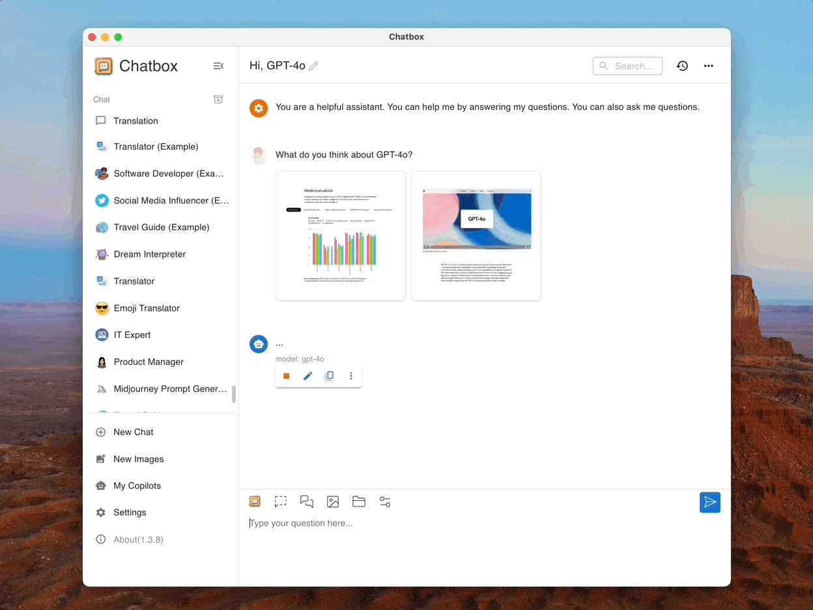

# 1 在服务器上安装 Ollama 框架&并使用 systemd 管理 Ollama

**在这里因为网络原因,我推荐大家直接到 github 官网下载压缩包,移入服务器中解压使用**

 1. 在 windows 中打开标签,选择最新的版本代号,选择 ollama-linux-amd64.tgz(我的 ubuntu 系统版本是 x86_64)

> 若不清楚自己的 Linux 系统版本输入 `uname -a`

 2. 创建文件夹/home/user/fxy-ollama 文件夹并解压到此处

> `tar -xzvf ollama-linux-amd64.tgz -C /home/user/fxy-ollama`

3. 接下来使用 systemd 管理 Ollama
**systemd 是 Linux 系统的现代服务管理工具，相比 nohup 或 screen 等方式，它提供了更稳定、可靠的管理方式，适合生产环境（长期运行的服务）**

```bash
/etc/systemd/system/ollama.service > /dev/null <<EOF [Unit] Description=Ollama Server After=network.target

[Service] User=kairos # 替换为你的用户名 ExecStart=/home/user/fxy-ollama/bin/ollama serve WorkingDirectory=/home/user Restart=always # 崩溃后自动重启 RestartSec=3 # 重启间隔（秒） Environment="OLLAMA_HOST=0.0.0.0" # 允许远程访问（可选）
# 资源限制示例（可选） # MemoryLimit=4G # CPUQuota=80%

[Install] WantedBy=multi-user.target EOF ​​(2) 启动并启用服务​​

sudo systemctl daemon-reload # 重新加载配置 sudo systemctl start ollama # 立即启动 sudo systemctl enable ollama # 开机自启

常用命令​​ bash sudo systemctl status ollama # 查看状态 sudo journalctl -u ollama -f # 实时查看日志 sudo systemctl stop ollama # 停止服务 sudo systemctl restart ollama # 重启服务
```

# 2 使用 Chatbox 连接到远程 Ollama 服务

 1. ##  Ollama 作为 systemd 服务运行，应使用==systemctl== 设置环境变量：

> 输入 `systemctl edit ollama.service` 编辑 systemd 服务配置。这将打开一个编辑器。
> 在 [Service] 部分下为每个环境变量添加 Environment：
> [Service]
> `Environment="OLLAMA_HOST=0.0.0.0"`
> `Environment="OLLAMA_ORIGINS=*"` 保存并退出。
> 重新加载 systemd 并重启 Ollama：
> `systemctl daemon-reload`
> `systemctl restart ollama`

 2. ## 在防火墙中允许 Ollama 服务的端口（默认为 11434）

> `sudo ufw allow 11434/tcp`

3. ## 在 Chatbox 中配置连接

> 在服务器输入 `ip a` ,获取 ip 地址例如 192.168.XX.XX
> 在 windows 终端输入 `curl http://192.168.XX.XX:11434/api/tags`
> 若返回 Ollama 的模型列表则代表内网穿透成功
> 最后在 Chatbox 中选择 Ollama API 输入 API 域名 `http://192.168.XX.XX:11434`
