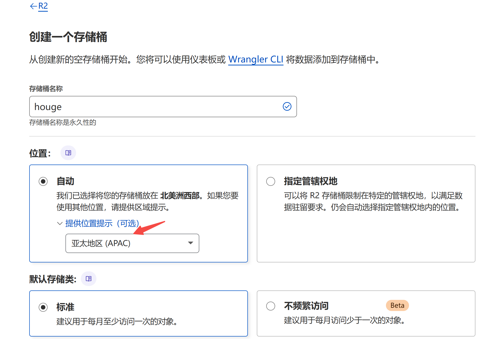
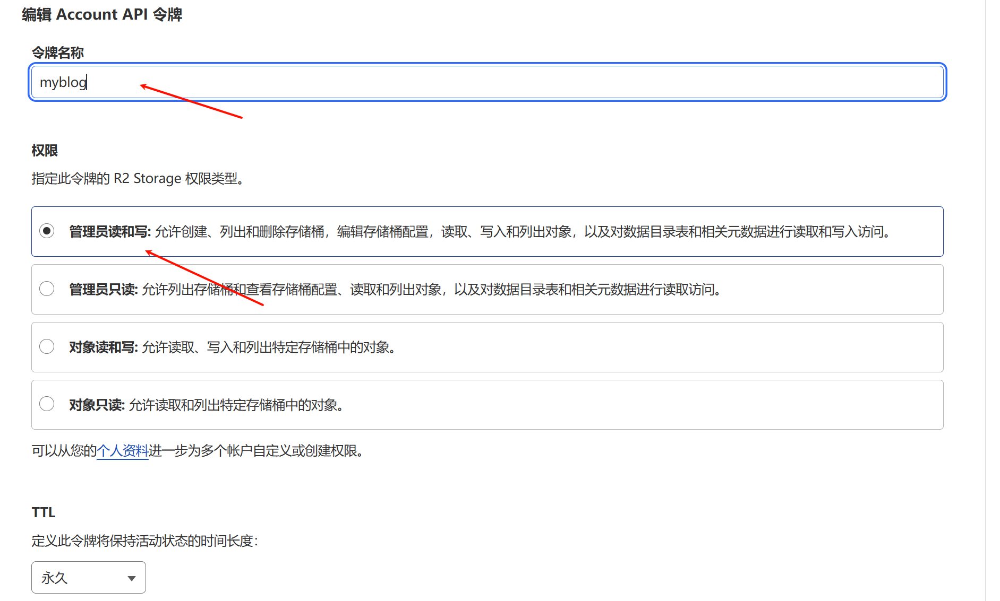
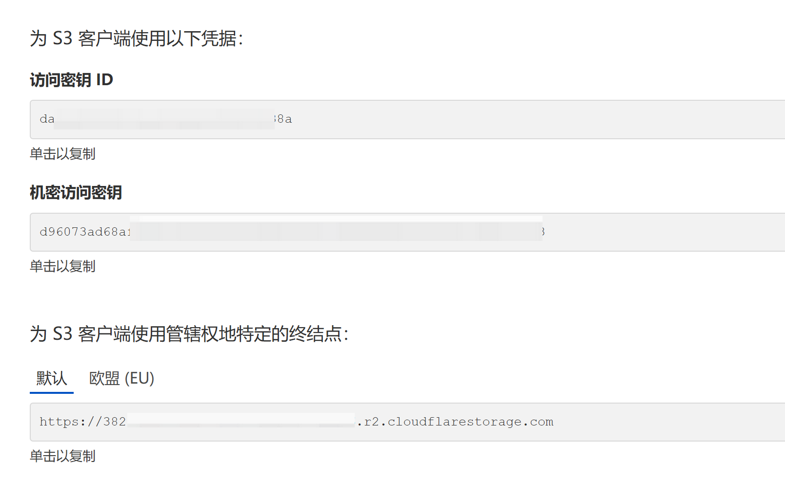
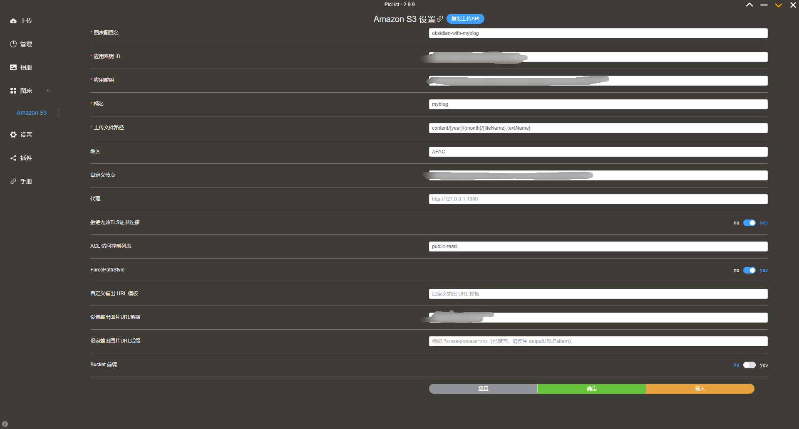
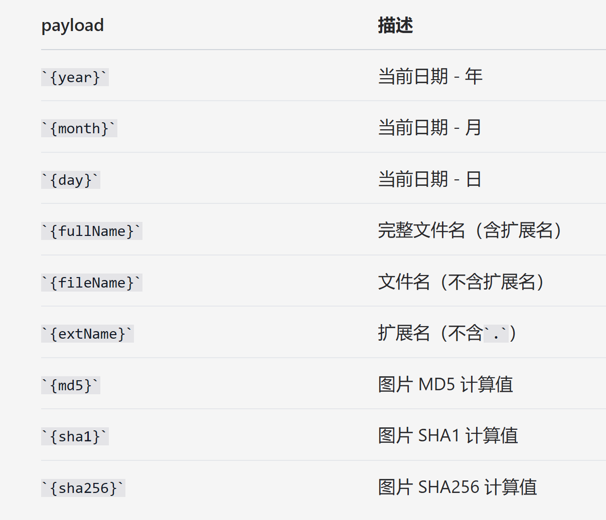
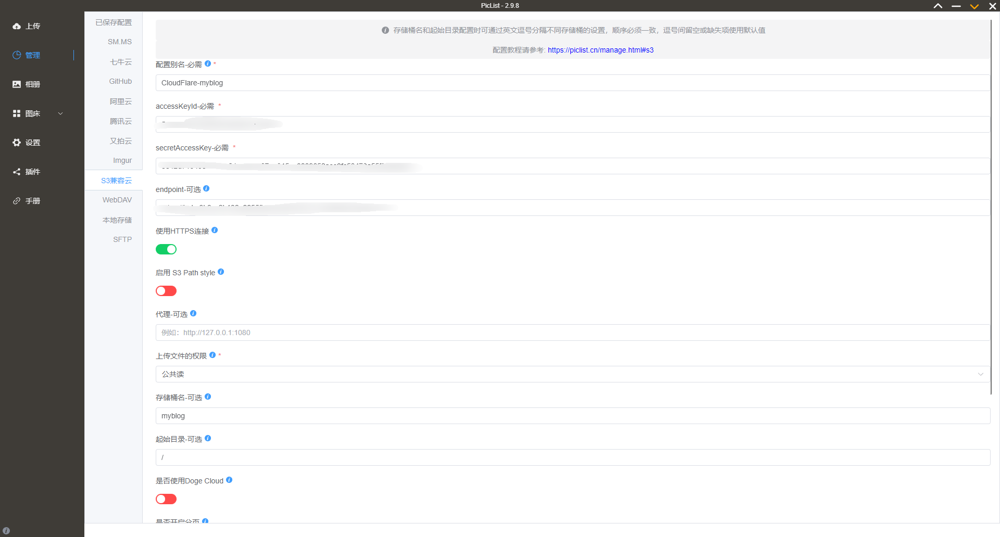
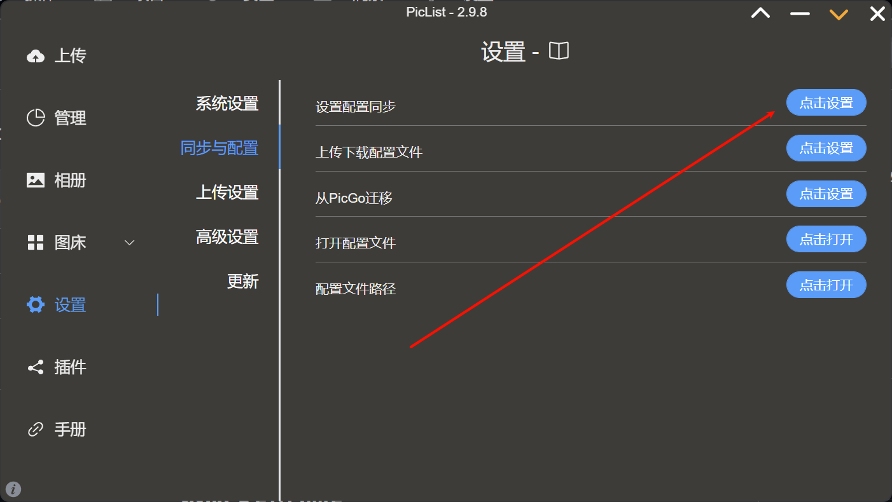

# 1 提前准备

1. 一个提前注册好的 Cloudflare 账号，并添加一个付费计划,不必担心扣费，可以选择 0 元免费计划
2. 一个提前注册好的域名，可以选便宜一些的,域名后缀无所谓，只是作为图片网址使用如果不想花一年十几块的域名费，也可以去网上找免费的域名使用
3. [Piclist软件](https://github.com/Kuingsmile/PicList)

# 2 创建 Cloudflare R2 存储桶

**R2 实际上是一个对象存储。Cloudflare 提供 10G 的免费存储和每月 1000 万次的免费访问**

1. 进入 [Cloudflare 仪表盘](https://dash.cloudflare.com/)，进入 R2 页面，为你的存储桶起一个名字，然后单击创建



2. **配置访问链接**
	 - 不要忘记，我们要搭的毕竟是个图床，不是网盘，接下来，我们要让其中的文件能够方便地通过链接从公网直接访问，让它变成真正意义上的图床
	 - Cloudflare 提供自己的子域域名，只不过功能受限，速度受限
	 - 所以建议自定义域访问 [域名的购买配置]()

# 3 S3 API 配置

> **接下来，我们看看如何通过调用 S3 API 进行上传下载，并通过 PicList 接入该 API 实现一站式、本地化的图床图片管理**

1. 要使用 S3 API，要获取 访问秘钥 ID（对应 AccessKeyId）、机密访问秘钥（对应 SecretAccessKey），以及终结点 /endpoint（后面用到）

- 回到 R2 页面,点击 API- 管理 API 令牌,输入令牌名称,指定相关权限



- 令牌创建成功后，下方即有 S3 API 需要的信息：



> 根据 Cloudflare 的安全策略，令牌信息页面一旦关闭，便永远不再展现，如果忘记了相应的信息，只能重新生成新令牌，所以请将令牌信息记录于可信的位置，妥善保管。

# 4 Piclist 图床配置

> 现在，事情来到了最后一步 —— 我们需要一个工具软件来接入我们配置好的 S3 API，方便我们从本地上传和管理图片，而不必每次都打开 cloudflare 面板，而 PicList 就是这方面的不二之选。

1. 打开 [PicList 官方网站](https://piclist.cn/)，下载安装软件
2. 载安装软件，打开后，可以看到，其已经内置支持了不少图床,但是…… 好像就是没有我们用的 cloudflare R2？别急，移步左侧的 “插件” 选项,搜索 s3
3. ~~插件有 s3 和 s3-lls,不知道是是不是 BUG,使用两者插件输出图片链接格式不同,对于 CF 图床生成的链接格式 (自定义域名 / 设定的文件路径 / 文件名),s3-lls 插件输出才符合~~

> 以上第 3 点的问题:
> 1. 不要勾选 ForcePathStyle
> 2. 不要勾选 Bucket 前缀


各项配置说明如下：

- 图床配置名：自定义。
- 应用秘钥 ID：对应 AccessKeyId / 访问秘钥 ID。
- 应用秘钥：对应 SecretAccessKey / 机密访问秘钥。
- 桶名：对应你在 Cloudflare 上创建的桶名称。
- 文件路径：定义桶内文件的上传存储路径,在这里我配置的是 content/{year}/{month}/{fileName}.{extName},这样其实很方便我后期管理。
- 地区：可以 AUTO 也可以 APAC(亚太地区,可能对访问速度有帮助吧)
- 自定义节点：对应 endpoint / 终结点。
- 自定义域名：对应 Cloudflare 自定义域或公共 R2.dev 存储桶 URL。

5. **下面详细说明 “文件路径” 选项**

- 该设置支持几个有固定含义的 payload 选项（如下所列），这些选项用于规定文件的上传路径和命名规则，而我们需要做的，就是根据需要进行恰当组合。



- 根据上图所列，文件路径可以写成这样：

```bash
{year}/{month}/{fileName}.{extName}
```

这样一个文件路径代表什么意思呢？举例来说，我在 2024 年 8 月上传了一张名为 “xxx.jpg” 的图片，按照如上的路径设置，它将会存储在如下位置：“桶名称 / 2024/08/”，而它的文件名就是 “xxx.jpg”，即：原文件名 + 原拓展名。

- 同理，我也可以换一种写法：

```bash
{year}/{month}/{fileName}/{md5}.{extName}
```

同样一张图片，在这样的文件路径下，会被上传到 “桶名称 / 2024/08/xxx/” 中，而图片本身会被重命名成 “该图片对应的 md5 字符串.jpg” 的形式。

# 5 Piclist 的管理功能 (可以直接管理你的云端图床)

> 云存储平台/云服务器和图床平台的管理是 PicList 新增的功能，在这里你可以：
>
> - 新建存储桶
> - 新建/重命名和删除文件夹
> - 重命名和批量删除文件
> - 快速批量复制文件公开链接
> - 批量获取私有文件的临时分享链接
> - 批量上传和下载各种格式的文件
> - 预览图片

1. 上面我们用的是 Cloudflare 的 r2 对象存储,所以我们就在 Piclist 配置管理
2. 点击管理选择 S3 兼容云,进行与上面相似的配置填写



3. 这样配置完成后，就可以直接在 Piclist 查看咱们云端的图床啦

# 6 关于配置的同步备份 (使用 Github 仓库备份)



> 这里我使用 Github 自建私有仓库 (Piclist_Backup ) 进行配置文件的保存

# 7 相关参考链接

> <https://www.zbf1009.top/archives/28>
>
> <https://tyxiaoming.xin/2025/01/12/%E6%90%AD%E5%BB%BA%E5%9B%BE%E5%BA%8A/>
