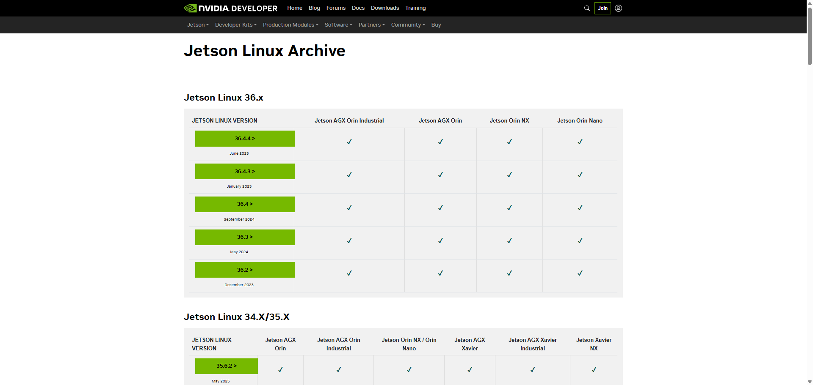
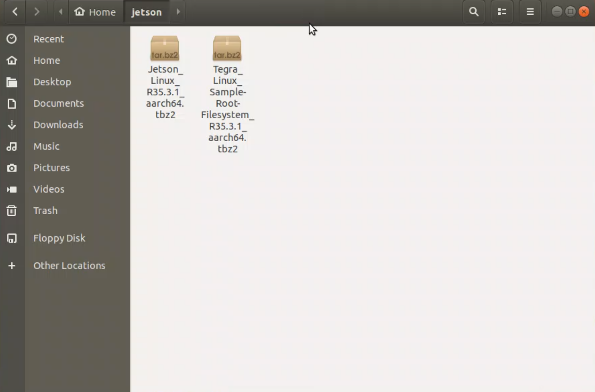
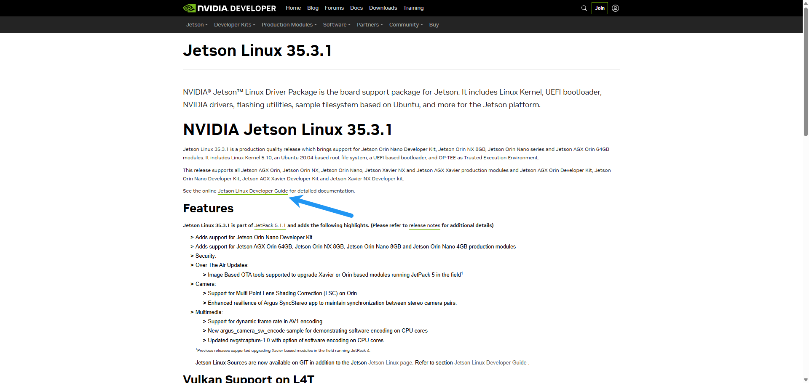
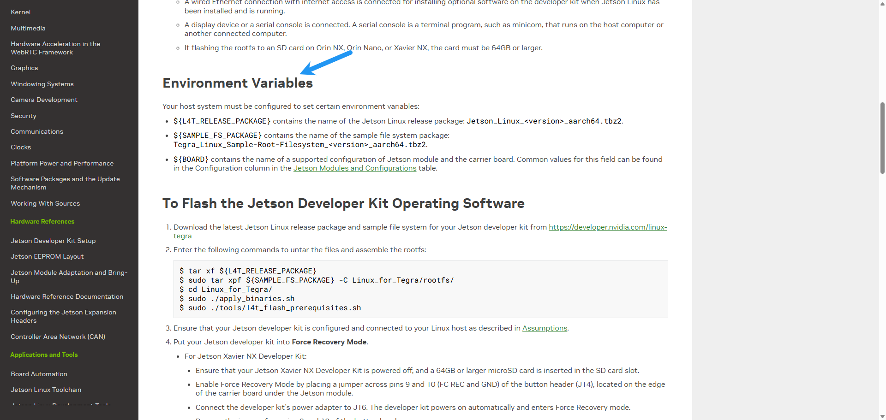
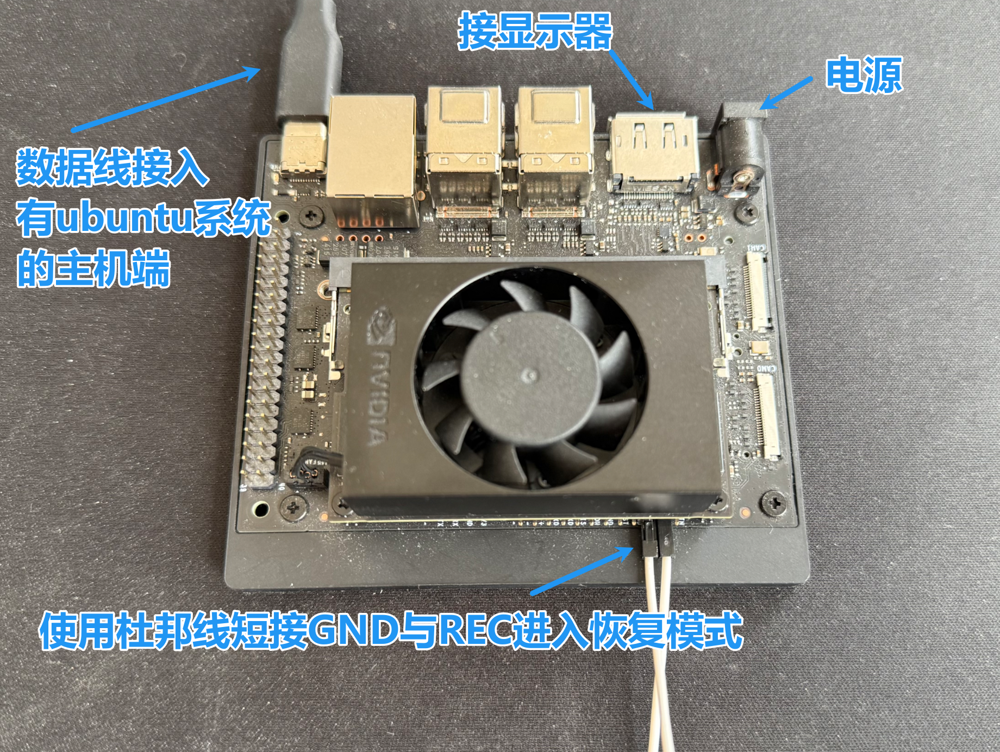
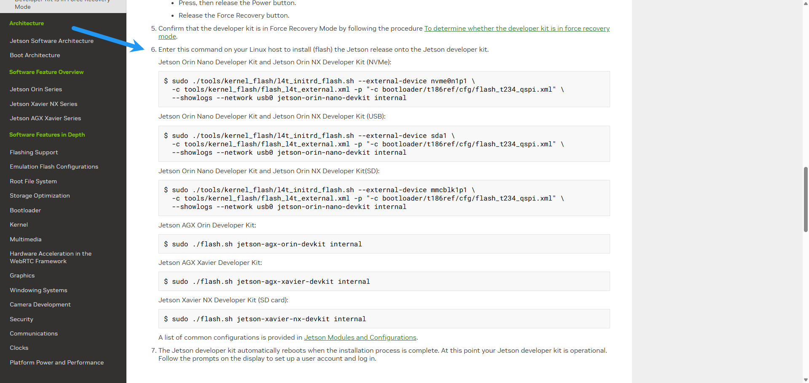
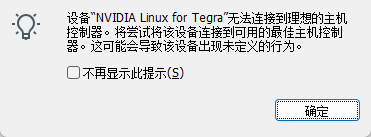
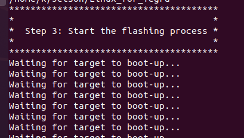
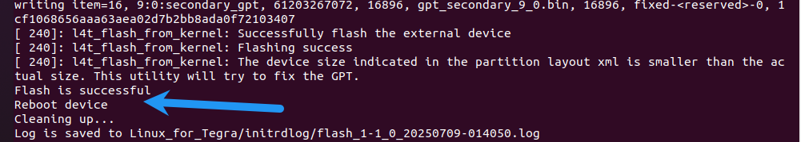

# 1 前言

Jetson 系列产品烧录系统的方法一般有两种，

- 一种为使用 NVIDIA 官方提供的 SDK manager 软件给 Jetson 设备烧录系统。
- 另一种即为当前文档所描述的，在安装 Ubuntu 系统的电脑主机上搭建系统烧写目录 Linux_for_Tegra，使用 flash.sh 脚本进行烧录，

此方法不仅仅适用于烧录系统，还可用于提取配置好的 Jetson 系统。

> 搭建 Jetson 系列产品烧录系统的环境需要在电脑主机上安装 Ubuntu 系统。
> 且安装的 Ubuntu 系统版本为 16.04 LTS 或者 18.04 LTS。

# 2 环境搭建过程

## 2.1 在安装有 Ubuntu 系统的电脑主机上安装应用库

```bash
sudo apt-get install qemu-user-static 
sudo apt-get install python 
```

搭建环境的过程需要以上应用库来将某些 NVIDIA 软件组件安装到 Jetson 开发工具包中。

## 2.2 从 NVIDIA 官网下载所需版本的驱动程序包，和示例根文件系统包

- 下载链接如下：<https://developer.nvidia.com/embedded/linux-tegra-archive>。



> 这里我选择较为稳定的版本 35.3.1

- 下载相关文件到 ubuntu 系统中



## 2.3 查阅指导文档

- 选择版本进入后点击查看指导文档（Jetson Linux Developer Guide）



- 选择目录中**Quick Start**，滑动到 Environment Variables 部分开始着手操作


# 3 开始动手烧录系统

- 通过以上操作,已经将相关驱动文件放入同一个文件夹 (我命名为 Jetson)
- Jetson 设备硬件操作


- 具体步骤:
1. 解压包

```bash 
1. cd jeston
2. tar xf Jetson_Linux_R35.3.1_aarch64.tbz2
3. sudo tar xpf Tegra_Linux_Sample-Root-Filesystem_R35.3.1_aarch64.tbz2 -C Linux_for_Tegra/rootfs/ #解压到Linux_for_Tegra/rootfs/中
4. cd Linux_for_Tegra/
5. sudo ./apply_binaries.sh 
6. sudo ./tools/l4t_flash_prerequisites.sh
```

2. 开始烧录

```bash
 cd Linux_for_Tegra
```

查看**Quick Start**的第六点,选择烧入的方式 (NVMe,USB,SD)



这里 Jetson orin Nano 是板载了固态 NVMe,故使用第一条命令

```bash
sudo ./tools/kernel_flash/l4t_initrd_flash.sh --external-device nvme0n1p1 \   -c tools/kernel_flash/flash_l4t_external.xml -p "-c bootloader/t186ref/cfg/flash_t234_qspi.xml" \   --showlogs --network usb0 jetson-orin-nano-devkit internal
```

> 在烧录过程中,Jetson 设备与主机连接会断开,并重新连接,要及时确认连接到主机中才能继续烧录

> 重新连接后若出现如图所示问题:
>
> 
>
> 可以换根数据线 or 换个在主机端换个数据口插

- 在烧录进行时,最后一步是 Step3



- 出现 successful 就是大功告成啦!


