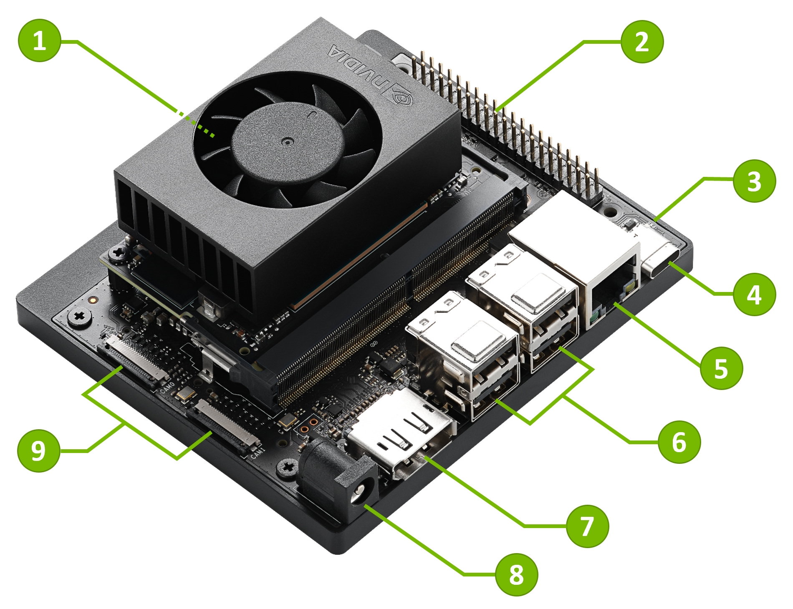

# 1 换源

## 1.1 **验证架构和源兼容性​**​

- 检查系统架构：

```bash
uname -m
```

- 如果是 `aarch64` 或 `arm`，必须使用 `ubuntu-ports` 镜像源（如清华、中科大）。
- 如果是 `x86_64`，可直接用普通 Ubuntu 源。
- 这里 Jetson 为 `aarch64`
- 查看源

```bash
ls -la /etc/apt/sources.list.d/
```

## 1.2 两种换源方式

### 1.2.1 方式 1.鱼香 ROS 一键换源

```bash
wget http://fishros.com/install -O fishros && . fishros
```

> **Note:**
> 不要清除第三方源: 这样会把 nvidia 源配置文件给删除

### 1.2.2 方式 2.输入以下代码换源

```bash
# 备份原有源 
sudo cp /etc/apt/sources.list /etc/apt/sources.list.bak 
# 使用 sed 替换为清华镜像源（适用于 ARM） 
sudo sed -i 's|ports.ubuntu.com/ubuntu-ports|mirrors.tuna.tsinghua.edu.cn/ubuntu-ports|g' /etc/apt/sources.list 
# 更新软件列表
sudo apt update
```

- 如果换源后出现问题，恢复备份：

```bash
sudo cp /etc/apt/sources.list.bak /etc/apt/sources.list 
sudo apt update
```

# 2 Jupyter Lab 的安装与使用

步骤 1: 更新 pip3 并安装 jupyter lab

```bash
sudo -H pip3 install --upgrade pip
pip3 install jupyter jupyterlab
sudo reboot
```

步骤 2: 生成 jupyter lab 配置文件

```bash
jupyter lab --generate-config
```

	会生成.jupyter文件,其文件夹下有jupyter_lab_config.py配置文件

```bash
# 查看jupyterlab位置
which jupyter-lab
# 输出
/home/user/.local/bin/jupyter-lab
```

```bash
sudo nano /etc/systemd/system/jupyter.service
#添加以下
[Unit]
Description=Jupyter lab
After=network.target

[Service]
Type=simple
User=k
ExecStart=/home/user/.local/bin/jupyter-lab --port 8888 --no-browser
WorkingDirectory=/home/user/
Restart=always

[Install]
WantedBy=multi-user.target

#启动服务
sudo systemctl enable jupyter.service
sudo systemctl start jupyter.service

#检查是否运行
sudo systemctl status jupyter.service
##输出(active (running))
```

# 3 部署深度学习

## 3.1 构建 Jetson-inference 环境

步骤 1.下载必要的依赖库

```bash
sudo apt-get update
sudo apt-get install git cmake
```

步骤 2.下载项目包

```bash
git clone https://github.com/dusty-nv/jetson-inference.git
cd jetson-inference/
git submodule update --init
```

步骤 3.下载 Python 项目包

```bash
sudo apt-get install libpython3-dev python3-numpy
```

步骤 4.使用 CMake 进行配置

```bash
cd  jetson-inference
mkdir build
cd build
cmake ../
```

中途跳出安装 pytorch,选择跳过,后面安装 (可选)

步骤 5.编译项目

```bash
cd jetson-inference/build
make
sudo make install
sudo ldconfig
```

## 3.2 安装 Pytorch 人工智能框架 (迁移学习重新训练网络)(可选)

```bash
cd jetson-inference/build
./install-pytorch.sh
```

# 4 Hello AI Word 图像分类推理

开启一个终端输入

```bash
#针对CSI摄像头
imagenet
#or
imagenet.py
```

```bash
#针对USB摄像头
imagenet /dev/video0
#or
imagenet.py /dev/video0
```
