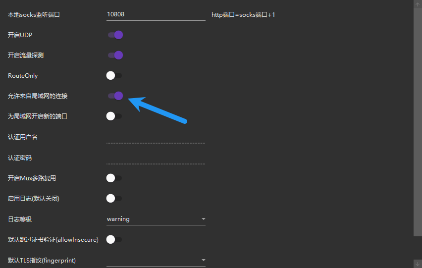

> **Note:**
> **Jetson 等设备不会自动继承主机的代理规则**

# 1 ​**​主机端代理设置​**​

首先确保主机已搭建代理服务（如 v2ray 等），并记录代理服务器的 IP 地址和端口号。例如：

```bash
#查看本地主机ip(不是固定的)
ipconfig
#IPv4 地址 
```

- 主机 IP：`192.168.3.68
- 代理端口：`10809`（HTTP）或 `10808`（SOCKS5）

## 1.1 **检查代理端口是否监听（Windows 主机）​**​

在 ​**​Windows PowerShell​**​ 中运行以下命令：

```bash
netstat -ano | findstr "10809"
```

- 如果输出中包含 `0.0.0.0:10809` 或 `192.168.3.68:10809`，说明代理服务正在运行并监听局域网。
- 如果只有 `127.0.0.1:10809`，说明代理仅限本地访问，需修改代理配置。

## 1.2 ​**​ 修改代理配置以允许局域网访问​**​

根据你的代理软件（如 Clash、Shadowsocks、v2ray 等）：

1. ​**​打开代理软件的配置文件​**​（通常是 `.yaml` 或 `.json` 文件）。
2. 找到监听地址（`bind-address` 或 `listen`），将其改为：

```bash
# 允许所有 IP 访问
listen: 0.0.0.0:10809 
```

或者

```bash
# 仅允许局域网访问
listen: 192.168.3.68:10809
```

这里我使用的 v2ray 代理,可以直接在设置中参数设置中允许局域网连接



3. 重启代理服务。

## 1.3 安全设置

- ​**​限制访问 IP​**​：
		在路由器或主机防火墙中，仅允许 Jetson 的 IP（如 `192.168.3.170）访问 `10808/10809` 端口。
- 在管理员终端输入

```bash
# 允许 Jetson (192.168.3.170) 访问 HTTP 代理端口 10809 
New-NetFirewallRule -DisplayName "Allow_Jetson_HTTP" -Direction Inbound -LocalPort 10809 -Protocol TCP -RemoteAddress 192.168.3.170 -Action Allow 
# 允许 Jetson 访问 SOCKS5 代理端口 10808 
New-NetFirewallRule -DisplayName "Allow_Jetson_SOCKS5" -Direction Inbound -LocalPort 10808 -Protocol TCP -RemoteAddress 192.168.3.170 -Action Allow
```

- 验证规则

```bash
`# 查看已创建的规则 
Get-NetFirewallRule -DisplayName "Allow_Jetson_*" | Format-Table DisplayName,Enabled,Action,Direction,RemoteAddress`
```

- 应输出

```bash
DisplayName        Enabled Action Direction RemoteAddress
-----------        ------- ------ --------- -------------
Allow_Jetson_SOCKS5   True Allow  Inbound   192.168.3.170
Allow_Jetson_HTTP     True Allow  Inbound   192.168.3.170
```

- 完成设置后，只有 Jetson 设备能使用你的代理，其他 IP 访问会被拒绝，安全性大幅提升！

---

# 2 **​Jetson 端设备配置​**​

## 2.1 ​**​系统级代理设置​**​

1. ​**​图形界面设置​**​

		- 进入 Ubuntu 的“设置” → “网络” → “网络代理”，选择“手动”模式。
		- 填写主机的代理 IP 和端口（如 HTTP/HTTPS 代理均设为 `192.168.3.68:10809`），保存并应用。
		- *注意*：此方法仅影响图形界面应用（如浏览器），终端仍需单独配置。
2. ​**​全局环境变量配置​**​

		- 编辑 `/etc/environment` 文件，添加以下内容（需管理员权限）：

``` bash
http_proxy="http://192.168.3.68:10809" 
https_proxy="http://192.168.3.68:10809" 
no_proxy="localhost,127.0.0.1"
```

```bash 
source /etc/environment
# 执行或重启生效。
```

*适用场景*：所有用户和终端命令（如 `apt`、`curl`）均通过代理。

> **Note:**
> **代理环境变量虽然已写入 `/etc/environment`，但并未被当前 Shell 会话加载**
> 所以建议重启 Jetson 设备,这会强制重新加载所有系统环境变量（包括 `/etc/environment` 中的代理配置）

## 2.2 ​**​终端临时代理（仅当前会话有效）​**​

在终端中临时设置代理:

```bash
export http_proxy=http://192.168.3.68:10809 
export https_proxy=http://192.168.3.68:10809
```

配置 HTTP 代理:

```bash
git config --global http.proxy http://192.168.3.68:10809
git config --global https.proxy http://192.168.3.68:10809
```

取消代理配置:

```bash
git config --global --unset http.proxy
git config --global --unset https.proxy
```

# 3 测试代理效果

- 在 Jetson 终端上测试输入

```bash
curl -x http://192.168.3.68:10809 -I https://www.google.com
```

如果返回 `HTTP/2 200`，说明代理已生效

- 测试无显示代理的 curl

```bash
	curl -v http://www.google.com
```

​**​预期结果​**​：

显示代理连接日志（如 `Connecting to 192.168.3.68:10809…`）
