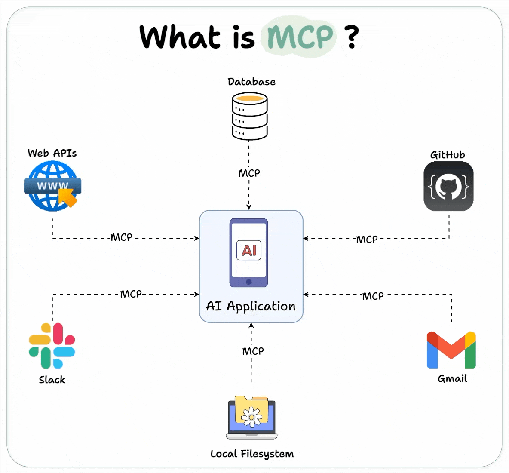

# 1 什么是 MCP 技术？

MCP，全称 Model Context Protocol（模型上下文协议），是一种开放标准协议，最早由 Anthropic 公司于 2024 年 11 月推出，旨在让大型语言模型（LLM）能够以标准化的方式无缝连接外部工具和数据源。

可以把 MCP 理解为 AI 界的“USB-C 接口”或“HTTP 协议”：它统一了 AI 模型与外部世界（如数据库、API、文件系统等）交互的方式，让开发者和用户不需要为每种工具或数据源单独开发适配接口，而是“插上就能用”。

# 2 MCP 的核心作用

- **标准化接口**：让 AI 模型和各种外部资源之间的通信变得统一、简单。
- **高效扩展**：开发者只需遵循 MCP 协议，就能让 AI 应用轻松接入新的工具或数据源，无需重复开发。
- **多模态支持**：不仅支持文本，还能处理图片、音频等多种数据类型。
- **上下文管理**：让 AI 模型能高效管理多轮对话和复杂的上下文信息。

# 3 MCP 的技术架构（0 基础易懂版）

MCP 采用典型的“客户端 - 服务器”架构，分为三个主要角色：

|角色|作用|举例|
|---|---|---|
|Host（主机）|运行 AI 应用的地方，集成 MCP 客户端，负责与用户交互|Claude Desktop、智能体 App、IDE 插件|
|Client（客户端）|嵌入在 Host 中的模块，负责和 MCP 服务器通信，是 AI 和外部世界的桥梁|MCP Client 插件|
|Server（服务器）|提供具体的数据、工具和提示模板等资源，供 AI 模型远程调用|数据库服务器、API 服务、文件服务器|

# 4 MCP 的工作流程

1. **初始化连接**：Host 中的 MCP Client 与 MCP Server 建立连接。
2. **请求资源/工具**：当 AI 模型需要外部数据或功能时，Client 向 Server 发出请求。
3. **执行操作**：Server 根据请求，执行相应操作（如查数据库、运行代码）。
4. **返回结果**：Server 将结果返回给 Client，Client 再传递给 AI 模型。
5. **AI 继续处理**：AI 模型用这些数据继续完成用户任务。

# 5 MCP 能做什么？

- 让 AI 自动查找和分析本地或远程文件
- 让 AI 直接调用数据库、Web API、执行代码等
- 让 AI 与各种外部系统（如 CRM、OA、邮件等）无缝集成
- 支持开发自己的 AI Agent（智能体），并快速扩展其能力

# 6 为什么 MCP 重要？

- **极大降低开发难度**：以前每接一个新工具都要写很多集成代码，有了 MCP 只需遵循协议即可。
- **让 AI 应用更强大**：AI 模型不再是“信息孤岛”，能实时访问和操作各种数据和工具。
- **推动 AI Agent 爆发**：MCP 让智能体开发和扩展变得前所未有的简单。

# 7 MCP 架构简化理解

MCP 采用**客户端 - 服务器（C/S）架构**，包含三个核心角色 ：

|角色|职责举例|类比|
|---|---|---|
|Host|用户直接操作的 AI 应用（如 AI 助手）|电脑主机|
|Client|在 Host 内，负责与 Server 通信|USB 驱动程序|
|Server|提供具体功能（如查天气、查文件）|U 盘/外设|

---

# 8 工作原理：一步步举例

# 9 **场景举例：AI 助手查天气**

1. **用户提问**
		你在 AI 助手（Host）里输入：“帮我查下明天北京的天气。”
		
2. **客户端转发请求**
		Host 中的 MCP Client 收到请求，发现需要用到“查天气”这个工具，于是向 MCP Server 发起调用请求 。
		
3. **服务器处理请求**
		MCP Server 收到请求，调用天气 API 获取北京明天的天气数据
		
4. **返回结果**
		MCP Server 把查到的天气数据返回给 Client，Client 再传回 Host。
		
5. **AI 助手答复**
		Host 把天气结果整理后，用自然语言回复你：“明天北京多云，最高温度 28℃。”

---

# 10 **核心流程总结**

- **连接建立**：Host 通过 Client 连接 Server，发现有哪些工具可用。
- **能力发现**：Client 向 Server 请求“你能做什么”，Server 返回工具清单（如查天气、查文件等）。
- **工具调用**：AI 模型根据用户需求，通过 Client 调用 Server 上的相关工具 。
- **结果整合**：Server 返回结果，Client 转交 Host，AI 模型用这些数据生成最终答复 。

---

# 11 关键术语简明解释

- **Tools（工具）**：AI 可以调用的具体功能（如查天气、发邮件）。
- **Resources（资源）**：AI 可以访问的数据内容（如本地文件、数据库）。
- **Prompts（提示）**：预设的任务模板或指令，帮助 AI 更好地理解和操作工具 。

---

# 12 总结类比

- 过去，AI 和每个外部系统都要单独“造轮子”对接，开发量大、难维护。
- 有了 MCP，AI 和工具都只需遵循 MCP 协议，就像所有设备都用 USB 接口，插上即用，极大简化了集成和扩展。

**一句话总结**：MCP 让 AI 像插 USB 一样，安全、标准地访问和调用各种外部工具和数据，实现“万物互联”的 AI 应用体验。
