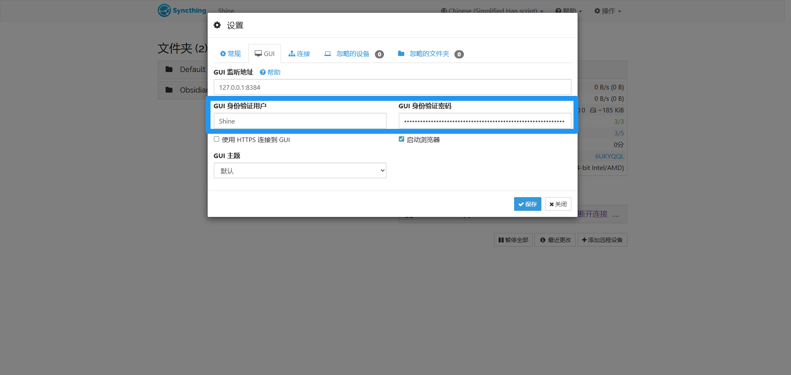
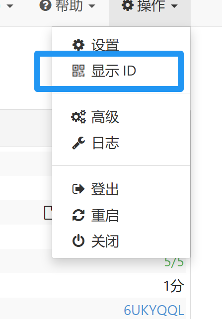
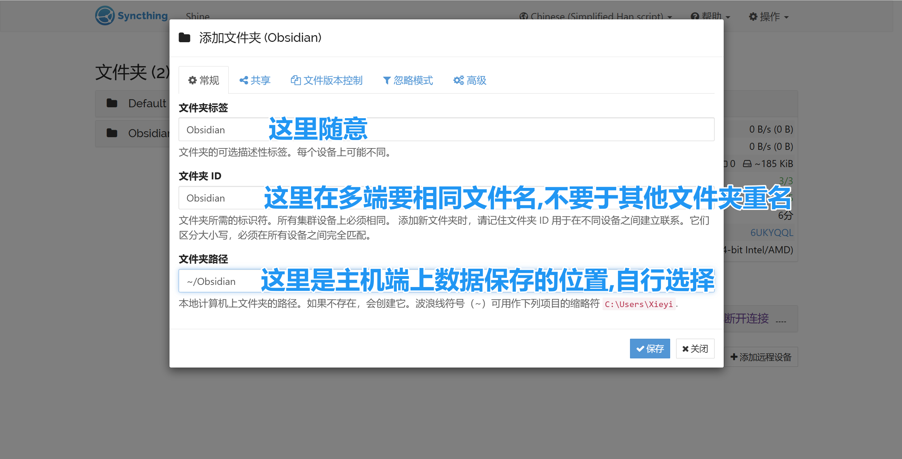
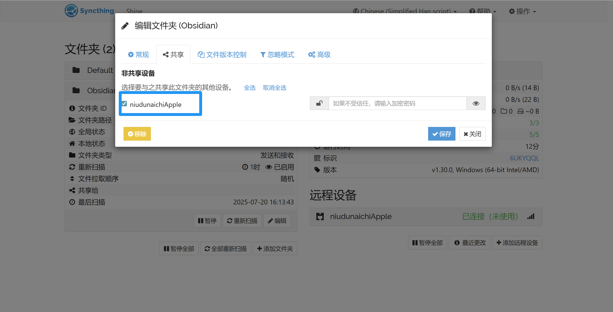
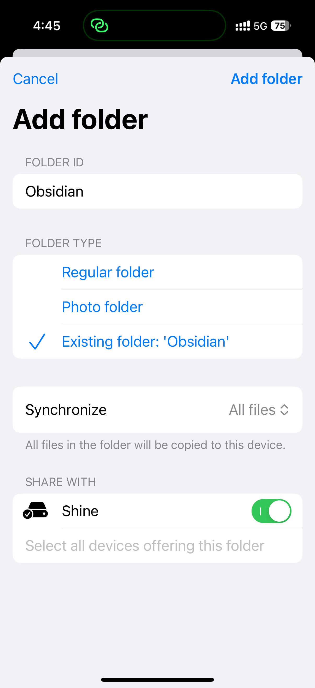
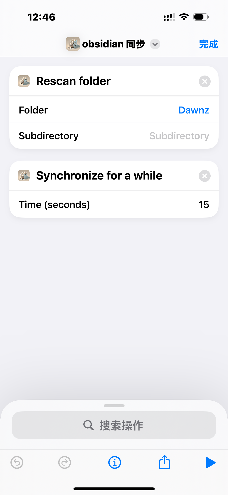
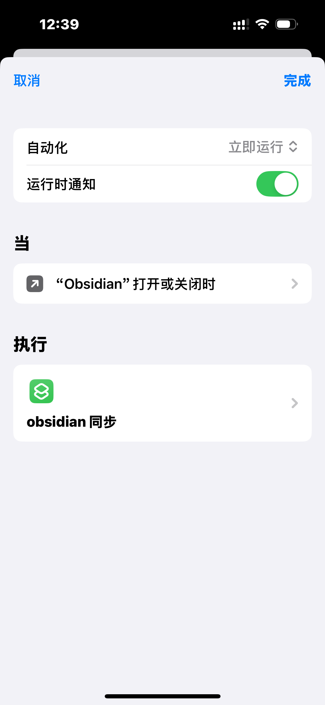

> 或许这就是最好的 Obsidian 全平台同步方案，甚至在国内可能优于官方的同步，因为它的同步速度取决于你内网带宽！并且它不局限于同步 Obsidian，也可以同步其他基于文件的的资料或者照片以及视频。

# 1 前言

Obsidian 的同步最大的问题是 IOS 端，在桌面端我们可以利用 OneDrive，Dropbox 等工具来同步，但是在 IOS 端我们无法使用这些工具来同步其他 app 的数据，所以如果不使用官方的同步，我们只能依赖插件，例如 `remotely-save` 和 `live-sync` 或者基于 `git` 的 http 插件以及 `working copy` 来同步文件，这些插件的最大问题就是性能和对冲突的处理策略不友好，那么 `syncthing` 便是终极的同步方案！

`Syncthing` 一个几乎实时的 Obsidian 同步方案，某些方面，它甚至优于官方同步。

# 2 Syncthing 的介绍

以下来自 [官网](https://syncthing.net/)

> Syncthing is a **continuous file synchronization** program. It synchronizes files between two or more computers in real time, safely protected from prying eyes. Your data is your data alone and you deserve to choose where it is stored, whether it is shared with some third party, and how it’s transmitted over the internet.

总结来说：syncthing 是一个开源的多端 p2p 同步工具。

# 3 Syncthing 的安装

桌面端的下载地址：[官网下载](https://syncthing.net/downloads/)

## 3.1 Windows 端

windows 端有 2 类客户端，一类是基于命令行 +web 端 ui 的客户端，一类是集成 ui 客户端，两种都是一样的。

### 3.1.1 集成 UI 客户端 (有本地 UI 界面)

[SyncTrayzor 下载地址](https://github.com/canton7/SyncTrayzor)

### 3.1.2 基于 WebUI 的 Base 客户端

建议下载安装版 [Windows 安装版](https://github.com/Bill-Stewart/SyncthingWindowsSetup/)

运行：开启菜单中搜索 `syncthing`，找到 `Start Syncthing` 打开即运行，没有窗口，没有托盘，这时我们打开浏览器，输入 `http://127.0.0.1:8384` 即可管理 [Syncthing](https://syncthing.net/)。

注意：安装版无法开机自启动，你可以安装以下步骤设置自启动。

1. 资源管理器打开 `%APPDATA%\Microsoft\Windows\Start Menu\Programs\Syncthing` 复制 `Start Syncthing` 这个快捷方式
2. `win+R` 输入 `shell:startup` 打开自启动文件夹
3. 把快捷方式粘贴到自启动文件夹中，下次开机会自动启动 syncthing
	你也可以记住这个文件夹的位置，或者把 `Start Syncthing` 和 `Stop Syncthing` 快捷方式复制到桌面用于手动启动和关闭，也可以从开始菜单启停。

## 3.2 iPhone 和 iPad 端

> iPhone 上一直没有一个友好的 syncthing 客户端，主要是无法跨沙箱，也就无法同步文件夹，这确实非常的难受，使用起来很受限，之前一直使用 `mobius sync` 这个收费的客户端，它能跨沙箱，但是如果体验后就必须保持后台，使用体验不算很好。直到开源的 `Synctrain` 的出现让 IOS 上的同步体验达到几乎无感。

### 3.2.1 Synctrain(免费开源,建议使用这个)

[Github 项目](https://github.com/pixelspark/sushitrain)

App Store：[Download on the App Store](https://apps.apple.com/nl/app/synctrain/id6553985316)(非国区哦)

TF：[Test beta versions through TestFlight](https://testflight.apple.com/join/2f54I4CM)

### 3.2.2 Mobius Sync

App Store 下载，国区 38 元买断，也很不错的 app。

**两个 app 最大的区别在于能否用快捷方式！**

# 4 Syncthing 配置（演示局域网下的同步）

以 Windows 端和 iPhone 同步为例，其他设备加入大同小异，但 syncthing 的中继和发现以及 stun 服务不友好，谨慎使用！

PC 端点击图标 or 自动启动

浏览器打开默认地址 `http://127.0.0.1:8384`

进入界面，设置 GUI 用户名和密码，避免同局域网中的隐私泄露

1. 在 2 端添加远程设备
	1. 右上角 `操作`>`显示ID` 会显示出来二维码。

	2. IOS 端打开 Synctrain-> `Devices`>`Add device` > `Scan using camera` 扫描二维码，右上角 `Add` 添加设备
	3. 如果正常，浏览器会收到一条添加设备的通知，点击 `添加设备` 即可连接设备
2. 添加共享文件夹 `Obsidian`
	1. 浏览器 `+添加文件夹`
		
	2. Obsidian 文件夹点击，然后 `编辑`,选择共享文件夹。
		

	3. iPhone 打开 `文件`app，在 `我的iPhone`>`Obsidian` 中新建一个 `Obsidian` 的文件夹用于保存 obsidian 的数据
	4. iPhone 端 `Folders` 中会显示发现了共享的 `Obsidian`，选择 `Select existing filder` > 第 3 步中新建的 Obsidian 文件夹，显示警告选择继续即可，`Synchronize` 选择 `All files`，点击右上角 `Add folder`
	5. 
3. 配置 Over，你可以在同步的文件任意的添加一些文件看看同步的情况如何
4. 配置自动化流程（灵魂）
	1. 新建一个快捷指令添加以下 2 个 `Synctrain` 动作即可
		- `Rescan folder`: `Folder` 选择上面的 `Obsidian` 文件夹，`Subdirectory` 留空
		- `Synchronize for a while`：`Time` 填写 `15`
		- 
	2. 打开自动化，新建一个自动化流程
		- `App` 选择 Obsidian，`已打开` 和 `已关闭` 全部勾选，点击立即运行
		- 下一步选择刚才创建的快捷指令
		- 完美自动化！
		- 

# 5 Syncthing 并非仅能同步局域网内的电脑，广域网内电脑照样好同步 (后续更新)

# 6 参考链接

> [Obsidian多端同步终极大法Syncthing、备份终极大法Kopia \| 老张博客](https://laozhang.org/archives/3506.html)
>
> [Obsidian利用Syncthing全平台同步终极方案 - Janz Blog](https://blog.zdawn.net/archives/obisidian-sync-to-syncthing)
