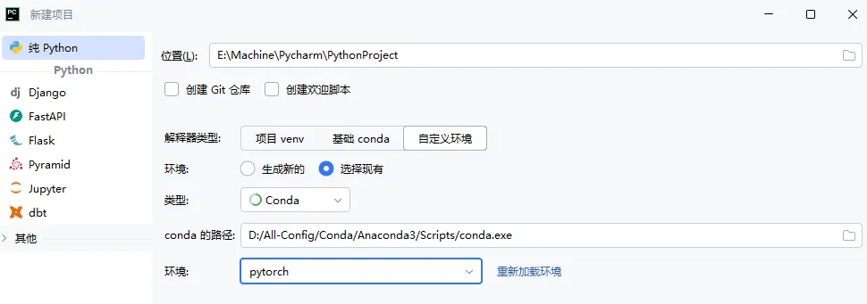
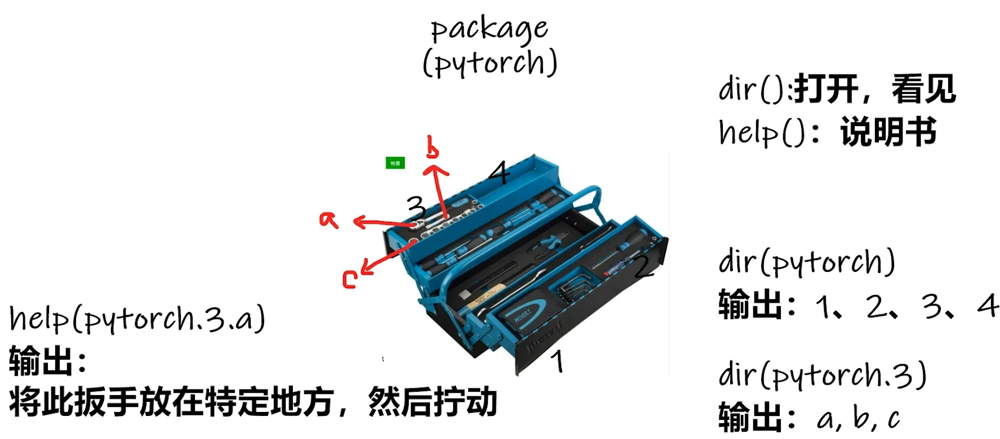
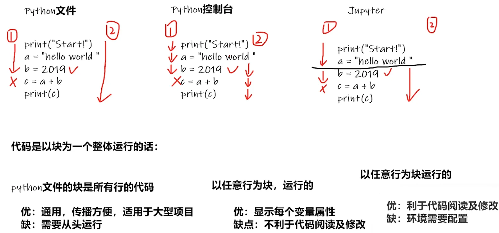

> 教程视频见 B 站 up 主 [小土堆](https://www.bilibili.com/video/BV1hE411t7RN?p=9&vd_source=db1ba321ac57d0740e3f5bc3b365ddff)

# 第 01 讲 配置📝

# 1.1 基本环境

## 1.1.1 Anaconda

> 安装当前最新版 Anaconda，安装时记好自己的 安装路径

| Anaconda | 链接 |
| --- | --- |
| 当前 | [https://www.anaconda.com/download/success](https://www.anaconda.com/download/success) |
| 其他 | [https://repo.anaconda.com](https://repo.anaconda.com/) |

> 也许，你之后会遇到不同的项目，需要使用到不同版本的环境
>
> 比如这个项目要用到 pytorch 0.4，另一个项目要用到 pytorch 1.0
>
> Anaconda 集成的 conda 就能够解决这个问题
>
> 它可以创造出两个屋子相互隔离，一个屋子放 0.4 版本，一个屋子放 1.0 版本。

```shell
# 启动Anaconda Prompt后，我们首先使用conda指令创建一个屋子，叫做pytorch

conda create -n pytorch python=3.6

# conda      指调用conda包

# create     创建的意思              

# -n         指后面的名字            

# pytorch    即名字(可以更改成自己喜欢的)   

# python=3.6 指创建的屋子为python3.6版本 

# 激活「pytorch」这个屋子

conda activate pytorch

# 查看「pytorch」中的包列表，目前还无pytorch包，需要安装

pip list
```

## 1.1.2 PyTorch

> 有显卡参考 cuda 版本选择 (无显卡选择 CPU 版本)，选择后复制相应指令

| PyTorch | 链接                                                                                       |
| ------- | ---------------------------------------------------------------------------------------- |
| 当前      | [https://pytorch.org/](https://pytorch.org/)                                             |
| 文档      | [https://pytorch.org/docs/stable/index.html](https://pytorch.org/docs/stable/index.html) |

```shell
# GPU版

pip3 install torch torchvision torchaudio --index-url https://download.pytorch.org/whl/cu118

# CPU版
pip3 install torch torchvision torchaudio
```

```shell
# 测试PyTorch

#1(pytorch) C:\Users\user
pip list

#2(pytorch) C:\Users\user
python

···

>>> import torch

>>> torch.cuda.is_available() #检查GPU是否可以被Pytorch使用

True
```

# 1.2 基本工具

## 1.2.1 PyCharm

> 安装当前最新版 PyCharm 专业版 [https://www.jetbrains.com/pycharm/download](https://www.jetbrains.com/pycharm/download)

新建项目 ： **「自定义环境」** -> **「选择现有」** -> **「Conda」** -> **「conda.exe 路径」** -> 选择创建的 pytorch 

```python
# Python 控制台 可以输入指令检测是否成功导入Conda的环境

import torch

torch.cuda.is_available()
```

```shell
# PyCharm 终端 不显示当前环境「pytorch」

解决办法：「设置」->「工具 - 终端」-> 把 「Shell 路径」 修改为 「cmd.exe」
```

## 1.2.2 Jupyter

```shell
# 进入「pytorch」环境

conda activate pytorch

# 通过这个指令就可以安装好Jupyter

conda install nb_conda

# 在pytorch中启动Jupyter

jupyter notebook
```

新建项目： **「New」** -> **「conda 的 pytorch 环境」** 

```python
# Jupyter Notebook 测试

import torch

torch.cuda.is_available()
```

> 针对于 ssh 服务器的情况下

```bash
#服务器上启动 Jupyter Notebook(指定了端口)
##--no-browser是 Jupyter Notebook 等命令行工具的一个启动参数，含义是启动服务器时不自动在本地主机打开浏览器
jupyter notebook --no-browser --port=8888

#在你的本地电脑上做 SSH 端口转发
ssh -L 8888:localhost:8888 cnb@10.1.0.100 #cnb@10.1.0.100是服务器的地址加用户名

#本地浏览器访问
http://localhost:8888/?token=xxxxxx
```

## 1.2.3 两个函数

> TIP
> - 查看帮助：PyCharm 中使用 **「ctrl+ 鼠标移动」** Jupyter 中使用 **「Name+??」**
> - 查看参数：PyCharm 中使用 **「ctrl+P」**

| 函数      | 功能                      |
| ------- | ----------------------- |
| dir( )  | 能让我们知道工具箱、工具箱中的分隔区有什么东西 |
| help( ) | 能让我们知道每个工具是如何使用         |



```python
# 导入 torch

import torch

# dir()

dir(torch)

dir(torch.cuda)

dir(torch.cuda.is_available) 

# help()

help(torch.cuda.is_available)
```

## 1.2.4 工具对比


