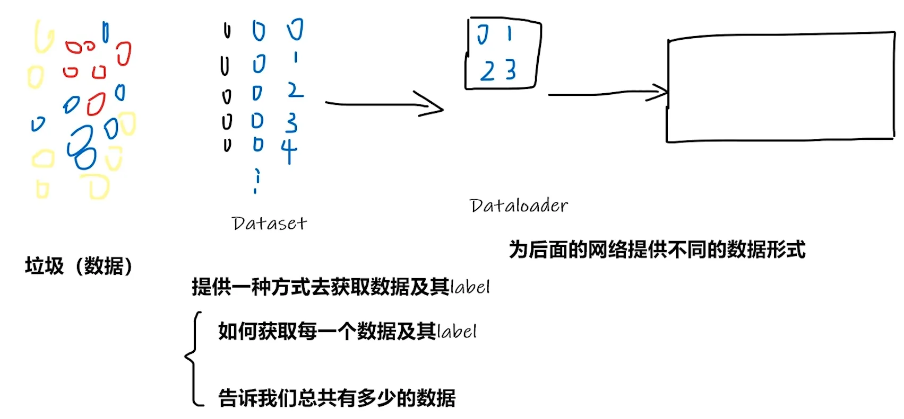
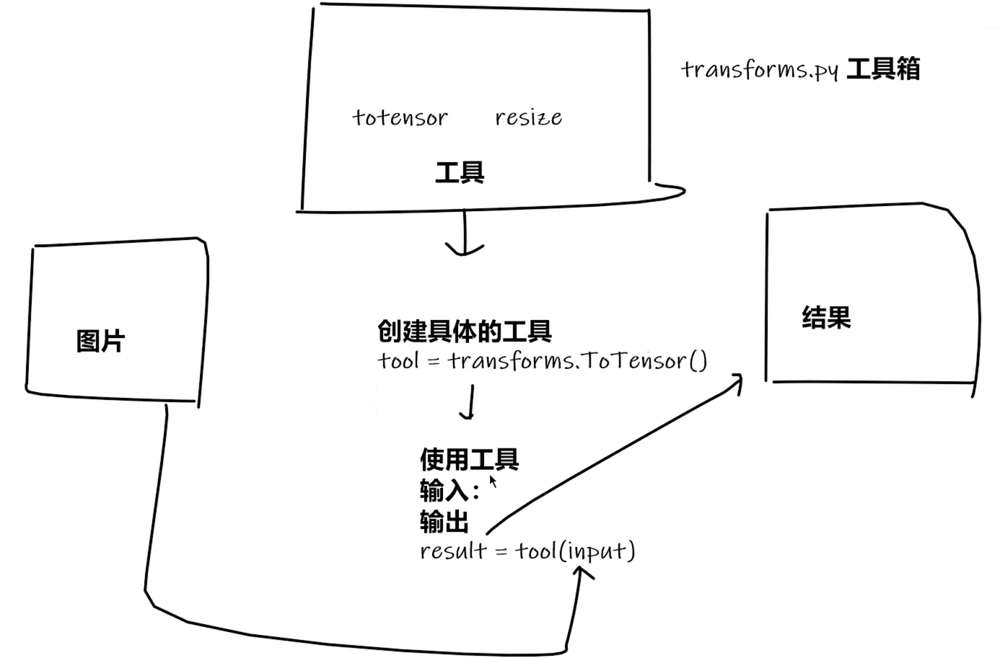
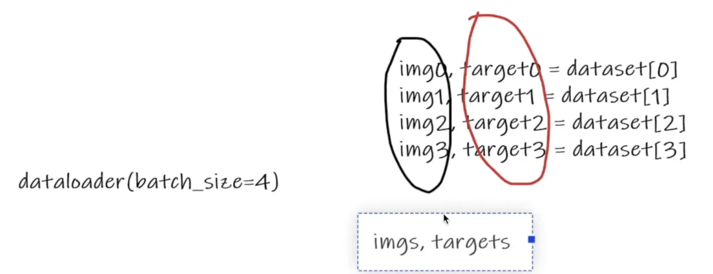

# 第 02 讲 数据📝

# 1.1 加载数据

## 1.1.1 Dataset

> PyTorch 有关加载数据的，主要涉及 **Dataset** 和 **DataLoader**
>
> 前者主要告诉后者如何 **获取数据** ，后者主要用于 **加载数据和为网络提供数据**



```text
Dataset

    需要继承抽象父类 \`Dataset\`

    需要重写两个方法 

        \`__getitem__\` 

        \`__len__\`
```

> read\_data.py

```python
from torch.utils.data import Dataset  

from PIL import Image  

import os  

  

# 自己封装的 MyData类  

class MyData(Dataset):  

    def __init__(self, root_dir, label_dir):  

        self.root_dir = root_dir  

        self.label_dir = label_dir  

        self.path = os.path.join(self.root_dir, self.label_dir)  

        self.img_path = os.listdir(self.path)  

  

    def __getitem__(self, idx):  

        img_name = self.img_path[idx]  

        img_item_path = os.path.join(self.root_dir, self.label_dir, img_name)  

        img = Image.open(img_item_path)  

        label = self.label_dir  

        return img, label  

  

    def __len__(self):  

        return len(self.img_path)  

  

root_dir = "dataset/train"  

ants_label_dir = "ants"  

bees_label_dir = "bees"  

ants_dataset = MyData(root_dir, ants_label_dir)  

bees_dataset = MyData(root_dir, bees_label_dir)  

  

# 第1种方式  

print(ants_dataset[0])  

  

# 第2种方式（根据上面返回的提示而修改）  

img, label = ants_dataset[0]  

img.show()  

  

# 测试两个数据集的拼接 未改变顺序，ants在前 bees在后  

train_dataset = ants_dataset + bees_dataset  

print(len(ants_dataset))  

print(len(bees_dataset))  

print(len(train_dataset))  

  

img, label = train_dataset[123]  

img.show()  

img, label = train_dataset[124]  

img.show()
```

## 1.1.2 TensorBoard

> 我们不知道一个神经网络执行具体细节是什么，要人工调试十分困难
>
> TensorBoard 可以将程序的执行步骤都显示出来，对训练的参数（如损失值）统计并以图展现

```shell
# 在「pytorch」环境中安装（记得关闭梯子）

pip install tensorboard
```

```text
SummaryWriter类

    创建一个事件文件，在给定的目录中添加摘要和事件

        参数1 存放日志的文件夹名

本节视频只用到两个方法

    1. add_image()        

        在事件文件中添加图片

    2. add_scalar()    

        在TensorBoard中添加标量数据

        该方法可以用来添加训练过程中的损失值、准确率等指标，以便于在TensorBoard中进行可视化和比较
```

> test\_tb.py

```python
from torch.utils.tensorboard import SummaryWriter  

  

writer = SummaryWriter("logs")  ##存储到logs的文件夹

  

# y = 2x  

# 同一个图像标题下，重复修改y值会导致，新图会包含之前的旧图(是个bug,可以通过删除logs文件再创建)  

for i in range(100):  

    writer.add_scalar("y = 2x", 2*i, i)  # 2*i y轴    i x轴

writer.close()
```

> 查看日志的命令

```shell
# logdir=事件文件所在的 文件夹名

tensorboard --logdir=logs

# 可以修改端口(原端口6006)

tensorboard --logdir=logs --port=6007
```

> tensorboard.py

```python
from torch.utils.tensorboard import SummaryWriter  

from PIL import Image  

import numpy as np  

  

writer = SummaryWriter("logs")  

  

# 第1步  

# image_path = "data/train/ants_image/0013035.jpg"  

# 第2步  

image_path = "data/train/bees_image/16838648_415acd9e3f.jpg"  

  

img_PIL = Image.open(image_path)  ##获取的图像为PIL型

img_array = np.array(img_PIL)  ##从numpy转换图片类型格式,转为numpy.ndarray型

print(type(img_array))  

print(img_array.shape) ##查看格式为 "HWC"

  

# 从PIL到Numpy，需要在add_image()中指定图像的每一维  

writer.add_image("test", img_array, global_step=1, dataformats="HWC")
	##`global_step=1`就是告诉TensorBoard：“这张图是训练到第1步时的样子”。通过调整这个值，你能在TensorBoard中滑动查看训练过程中图像的演变。
	##这里的dataformats="HWC"是格式,H代表高度,W代表宽度,C代表通道  

  
writer.close()
```

# 1.2 转换数据

## 1.2.1 Transforms(一个工具箱)

> Transforms 主要是用于图像变换的操作，可以对图像进行裁剪、标准化等

其包括很多常用的图像处理方法，比如 `transforms.ToTensor()` 

> **为什么用 Tensor 数据类型？**
> Tensor 类型中的很多属性我们都需要在神经网络中用到，如反向传播、梯度等

> test\_tf.py

```python
from PIL import Image  

from torch.utils.tensorboard import SummaryWriter  

from torchvision import transforms  

  

img_path = "data/train/ants_image/0013035.jpg"  

img = Image.open(img_path)  

print(img)  

  

# 使用transforms  

 

> ToTensor() 可传入\`PIL Image\` 和 \`numpy.ndarray\` 两种图片格式  
> 
>     PIL Image：即用PIL的Image工具打开图像的格式  
> 
>     numpy.ndarray：即用OpenCV打开图像的格式（所以一般用这种方式打开，不用再转换图像了）  


tensor_trans = transforms.ToTensor() ##创建tensor_trans工具 

tensor_img = tensor_trans(img) ##使用tensor_trans工具将img转为Tensor型img 

print(tensor_img)  

  
# 创建tensorboard日志 可以使用tensorboard直观展示

writer = SummaryWriter("logs")  

writer.add_image("Tensor_img", tensor_img, 0)  

writer.close()
```

> 补充: 使用 opencv 读取图片

```python
import cv2

cv_img = cv2.imread(img_path)

print(cv_img) ## 使用opencv读取图片,可以直接得到numpy.ndarray类型img
```

> 多关注 **「输入、输出」** 类型，不会的多看 **「官方文档」**
> 关注方法需要的 **「参数」** ，不知道返回值的时候 「Print」打印查看

> call.py
> 展示 Python 中 __call__ 的用法

```python
# __call__ 让对象可以直接当函数使用

# 测试

class Person:  

    def __call__(self, name):  

        print(" Hello "+name)  

  

    def hello(self, name):  

        print("Hello "+name)  

  

person = Person()  

#以下两种调用方式
person("zhangsan")## 调用的__call__

person.hello("lisi")## 调用的hello对象名
```

> useful\_tf.py
> 展示 transforms 的一些功能

```python
from PIL import Image  

from torch.utils.tensorboard import SummaryWriter  

from torchvision import transforms  

  

writer = SummaryWriter("logs")  

img = Image.open("images/0013035.jpg")  


print(img)  # 打印后得知，图像为RGB三通道  

  

# 01 transforms.ToTensor()  

trans_totensor = transforms.ToTensor()  

img_tensor = trans_totensor(img)  

print(img_tensor[0][0][0]) ## 打印张量中第一个通道、第一行、第一列的像素值,这通常是一个介于0到1之间的浮点数  

writer.add_image("ToTensor", img_tensor, 0) ##  0：全局步数(global step)，用于训练过程中跟踪不同步骤的图像  

  

# 02 transforms.Normalize()

# 是一种归一化,目的是将数据调整到特定的范围内，使其更适合模型训练或分析
# 公式 output[channel] = (input[channel] - mean[channel]) / std[channel]  

trans_norm = transforms.Normalize(mean=[0.5, 0.5, 0.5], std=[0.5, 0.5, 0.5]) 
## mean平均值;std标准差  
## 创建了一个标准化转换器，对RGB三个通道执行：减去均值0.5 ; 除以标准差0.5
## 公式为：normalized = (input - mean) / std

img_norm = trans_norm(img_tensor) ## 输入01得到的Tensor型img  

print(img_norm[0][0][0])  

writer.add_image("Normalize", img_norm, 0)  

  

# 03 Resize  用于调整图像尺寸

# 图像为PIL，经过Resize后，仍为PIL.设计初衷就是处理PIL图像，并保持相同的数据类型输出 
# transforms.Resize()可以接受两种参数形式：1. 单个整数：将图像的短边缩放到该尺寸，长边按比例缩放 2. 元组(h,w)：将图像精确缩放到指定尺寸

trans_resize = transforms.Resize((512, 512))  

img_resize = trans_resize(img)  

# 将PIL转为Tensor  

img_resize = trans_totensor(img_resize)  

writer.add_image("Resize", img_resize, 0)  

  

# 04 Compose 可以将几个转换组合在一起，先resize，再tensor
# Compose中的操作顺序必须合理

trans_resize_2 = transforms.Resize(512)  

trans_compose = transforms.Compose([trans_resize_2, trans_totensor])  ##相当于合并两个过程

img_resize_2 = trans_compose(img)  

writer.add_image("Resize", img_resize_2, 0)  

  

# 05 RandomCrop  随机裁剪

trans_random = transforms.RandomCrop(512)  

trans_compose_2 = transforms.Compose([trans_random, trans_totensor])  

for i in range(10):  ##随机裁剪十个

    img_crop = trans_compose_2(img)  

    writer.add_image("RandomCrop", img_crop, i)  

  

writer.close()
```

> dataset\_tf.py
> 展示 transform 与数据集使用

```python
import torchvision  

from torch.utils.tensorboard import SummaryWriter  


  

dataset_transforms = torchvision.transforms.Compose
([  

    torchvision.transforms.ToTensor() 
	## 这里可以进行其他操作(比如resize等等)

])  

train_set = torchvision.datasets.CIFAR10(root='./dataset',

                                        train=True,

                                        transform=dataset_transforms,

                                        download=True)  

test_set = torchvision.datasets.CIFAR10(root='./dataset',

                                        train=False,

                                        transform=dataset_transforms,

                                        download=True)  

  

# 01 查看一下数据信息  

print(test_set[0])  

## 输出 (<PIL.Image.Image image mode=RGB size=32x32 at 0x23653E11F60>, 3)

img, target = test_set[0]  

print(img)  

print(target) ## 标签也就是label

  

print(test_set.classes)  

print(test_set.classes[target]) # 输出cat(对应3)  

img.show()  

  

# 02 通过tensorboard查看  

writer = SummaryWriter("logs")  

  

for i in range(10):  

    img, target = train_set[i]  

    writer.add_image("test_set", img, i)  

  

writer.close()
```

> 查看 logs 日志

```python
tensorboard --logdir="logs"
```

## 1.2.2 DataLoader

> batch_size 取四个数据打包成 imgs.targets,相当于融合在一起



> dataloader.py

```python
import torchvision  

from torch.utils.data import DataLoader  

from torch.utils.tensorboard import SummaryWriter  

  
# 准备测试集
test_data = torchvision.datasets.CIFAR10("./dataset", 

                                        train=False,

                                        transform=torchvision.transforms.ToTensor(),

                                        download=True)  

# 加载测试集
test_loader = DataLoader(test_data,batch_size=64,shuffle=True,

                                                num_workers=0,

                                                drop_last=True)  
## shuffle=True表示在每次遍历数据集（即每个 epoch）前，将数据顺序打乱
## num_workers=0 表示 使用主线程加载数据（加载将是同步进行的）
  

# 查看测试数据集中第一张图片  

img, target = test_data[0]  

print(img.shape)  

print(target)  

  

writer = SummaryWriter("dataloader")  

for epoch in range(2):  ## 遍历两轮

    step = 0  

    for data in test_loader:  

        imgs, targets = data  

        # print(imgs.shape)  

        # print(targets)        

        writer.add_images("Epoch:{}".format(epoch),imgs,step)  

        step = step + 1  

  

writer.close()
```
