# 第 03 讲 神经网络📝

# 1.1 基本骨架

## 1.1.1 Module

> `torch.nn` 是非常常用的包，其中 `torch.container` 中的 **「Module」** 是所有神经网络的基类
>
> 自己定义的模型需要实现「Module」的 `__init__` 和 `forward` 函数

> 前向传播
>
> 此图的 F. 是下面代码块定义的 -> import torch.nn.functional as F
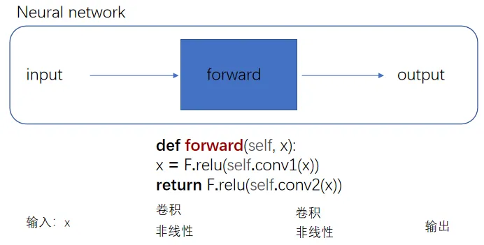

> nn\_module.py

```python
import torch  

from torch import nn  

  

class Tudui(nn.Module):  

    def __init__(self):  

        super().__init__()  ## 习惯性添加,调用了父类 `nn.Module` 的初始化方法,及时下面过程没有使用 `nn.Module` 的高级功能


    def forward(self, input):  ## 当你自定义一个模型，只要继承自 `nn.Module`，就必须定义一个名为 `forward(self, …)` 的方法，用来描述模型的前向传播逻辑

 
        output = input + 1  

        return output  

  

tudui = Tudui()  

x = torch.tensor([1.0])  

output = tudui(x)  

print(output)
# 输出tensor([2.])PyTorch 默认的张量打印格式，表示其值为 2.0
```

## 1.1.2 Layers

## 1.1.2.1 Ⅰ 卷积层

> 卷积层中最常使用 **Conv2d** -- 因为图像为二维
>
> 卷积核的 **「size」** 一般是预定义好的
>
> 卷积核的 **「weights」** 一般是先初始化然后通过不断迭代学习而来的

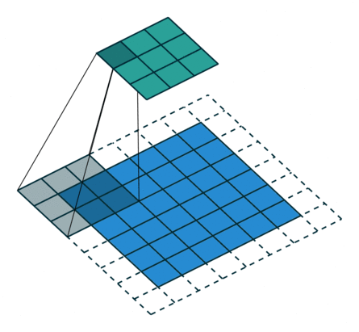

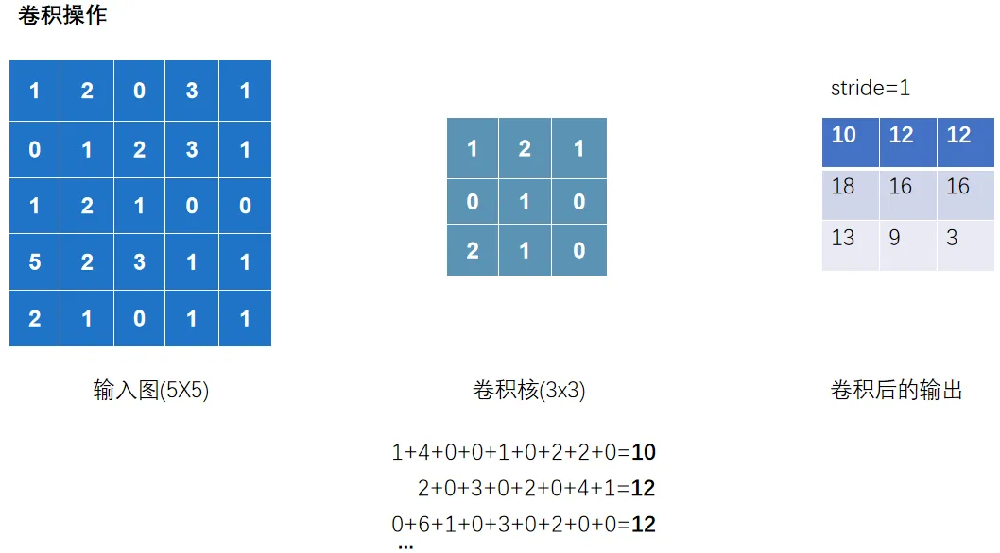

> Original illustration unavailable: [source image](https://www.morinha.cc/_astro/d71ecdc3e869d3439ddcb62e22cc892e.CFvv4ckn_DI5V1.webp).

> 以上完整输出为:
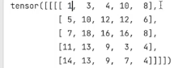

> nn\_conv.py

```python
import torch  

import torch.nn.functional as F  

  

input =torch.tensor([[1,2,0,3,1],  

                     [0,1,2,3,1],  

                     [1,2,1,0,0],  

                     [5,2,3,1,1],  

                     [2,1,0,1,1]])  

  

kernel = torch.tensor([[1,2,1],  

                       [0,1,0],  

                       [2,1,0]])  

 
print(input.shape)  

print(kernel.shape)  
#以上输出torch.Size([5,5])和torch.Size([3,3]),不满足使用条件-> - reshape 是为了让数据 shape 满足 conv2d 的要求

# 01 看shape发现不满足,修改一下shape
  

input = torch.reshape(input,(1,1,5,5))  

kernel = torch.reshape(kernel,(1,1,3,3))  

  

## 02 卷积 conv2d

output = F.conv2d(input,kernel,stride=1) ## 这里的stride=1代表上下左右各移动一个像素(去扫描)

print(output)  

  

output2 = F.conv2d(input,kernel,stride=2)  

print(output2)  

  

output3 = F.conv2d(input,kernel,stride=1,padding=1)  ## padding=1代表上下左右填充1个像素

print(output3)
```

> 观察以下过程
>
> 输出 channel=2,代表有两个卷积核去扫描.并且两个卷积核数值是随机的

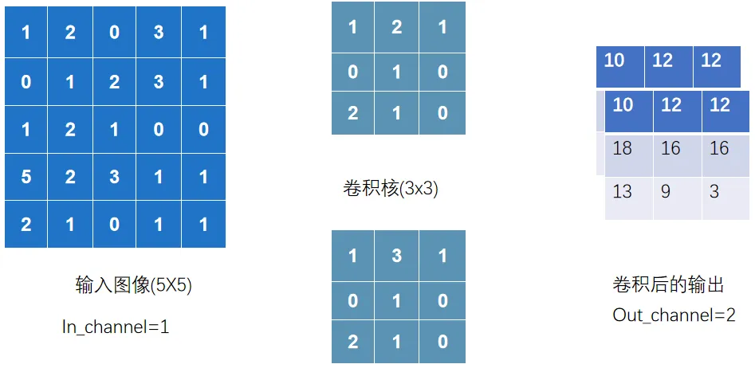

> nn\_conv2d.py
>
> 以下正式讲解卷积层的使用

```python
import torch  

import torchvision  

from torch import nn  

from torch.nn import Conv2d  

from torch.utils.data import DataLoader  

from torch.utils.tensorboard import SummaryWriter  

from urllib3.filepost import writer  

  
# 准备数据集
datset = torchvision.datasets.CIFAR10("data",  

                                      train=False, ## 训练数据集太大了,就用测试数据集 

                                      transform=torchvision.transforms.ToTensor(),  

                                      download=True)  

  
# 加载数据集
dataloader = DataLoader(datset,batch_size=64)  

  
# 自定义神经网络
class Tudui(nn.Module):  

    def __init__(self):  

        super().__init__()  

		
## 创建conv1,表示你的第一个卷积层，并且后续可以在`forward`方法里直接用
        self.conv1 = nn.Conv2d(in_channels=3,
		
							  out_channels=6,
							   
                               kernel_size=3, ##卷积核大小
							   
                                    stride=1,
							   
									padding=0)  


    def forward(self,x):  

        x = self.conv1(x)  

        return x  

  
# 初始化这个网络

tudui = Tudui()  

## print(tudui)  


writer = SummaryWriter("logs")  

step = 0  

for data in dataloader:  ## `data` 只是一个变量名 它代表每次迭代从 `dataloader` 取出的那 1 批数据

    imgs, targets = data  

    output = tudui(imgs)  

    # print(imgs.shape)  

    # print(output.shape)  

    writer.add_images("input",imgs,step) # 输入的torch.Size([64, 3, 32, 32]) 在卷积层中运行后 会输出 [64, 6, 30, 30] 有6通道;TensorBoard add_images 只支持 1 或 3 通道图片，不支持 6 通道


    output = torch.reshape(output,(-1,3,30,30)) 
	## `-1` 代表自动根据其他维度推算 batch 数量, 意思就是这个-1会经过reshape后自动计算成对应的数值.比如将以上[64, 6, 30, 30]的6压缩成两组3的话,就变成[128, 3, 30, 30]
    
  
	
    writer.add_images("output",output,step) # 输出的torch.Size([128, 3, 30, 30])  

    step = step + 1

  

writer.close()
```

## 1.1.2.2 Ⅱ 池化层

> 池化层中最常使用 **「MaxPool2d」**
>
> 其一是对卷积层所提取的信息做更一步降维， **减少计算量** ，
>
> 其二是 **加强图像特征的不变性** ，使之增加图像的偏移、旋转等方面的鲁棒性

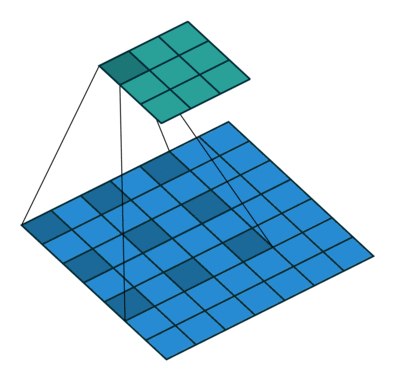

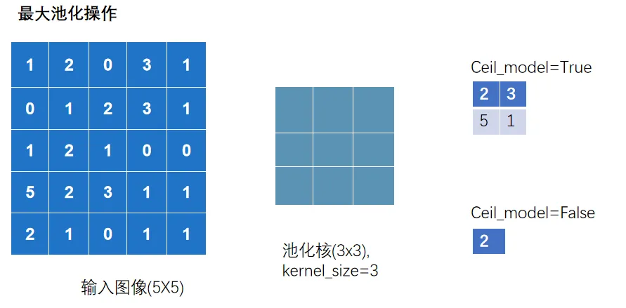

> nn\_maxpool.py

```python
import torch  

import torchvision  

from torch import nn  

from torch.utils.data import DataLoader  

from torch.utils.tensorboard import SummaryWriter  

  

# 01 测试最大池化的实现  

# input =torch.tensor([ [1,2,0,3,1],  

#                       [0,1,2,3,1],  

#                       [1,2,1,0,0], 

#                       [5,2,3,1,1],

#                       [2,1,0,1,1]  ],

#                      dtype=torch.float32)
						## 这是因为池化操作在底层实现时，用的都是浮点计算

# input = torch.reshape(input,(-1,1,5,5))  

# print(input.shape)  
	##输出torch.Size([1,1,5,5])

#  

# class Tudui(nn.Module):  

#     def __init__(self):  

#         super().__init__()  

#         self.maxpool1 = nn.MaxPool2d(kernel_size=3,ceil_mode=True)  

#  

#     def forward(self, input):  

#         output = self.maxpool1(input)  

#         return output  

#  

# tudui = Tudui()  

# output = tudui(input)  

# print(output)  

   

# 02 针对数据集测试  

dataset = torchvision.datasets.CIFAR10(root='./data',  

                                       train=False,  

                                       transform=torchvision.transforms.ToTensor(),  

                                       download=True)  

dataloader = DataLoader(dataset,batch_size=64)  

  

class Tudui(nn.Module):  

    def __init__(self):  

        super().__init__()  

        self.maxpool1 = nn.MaxPool2d(kernel_size=3,ceil_mode=False)  

  

    def forward(self, input):  

        output = self.maxpool1(input)  

        return output  

  

tudui = Tudui()  

  

writer = SummaryWriter("logs")  

step = 0  

for data in dataloader:  

    imgs, targets = data  

    writer.add_images("input",imgs,step)  


    output = tudui(imgs)  

  

    writer.add_images("output",output,step)  

    step = step + 1  

  

writer.close()
```

## 1.1.2.3 Ⅲ 激活层

> 激活层一般采用 **「非线性激活」** ，神经网络中引入非线性的特质，才能训练出符合各种特征的模型
>
> 非线性激活函数有很多，如比较常见 **「ReLU」** 和 **「Sigmoid」**

> nn\_relu.py

```python
import torch  

import torchvision  

from torch import nn  

from torch.nn import ReLU  

from torch.utils.data import DataLoader  

from torch.utils.tensorboard import SummaryWriter  

  

from nn_conv2d import dataloader  

  

# # 01 测试ReLU  

# input = torch.tensor([[1,-0.5],  

#                        [-1,3]])  


# output = torch.reshape(input,(-1,1,2,2))  
	## 输出( [[[[1, -0.5],
	##            [-1, 3]]]] )
	## 如果仅仅在此测试Relu中,可以不需要reshape,但在Conv2d这样的情况下就需要
	
# print(output.shape)  
	## 输出(1,1,2,2)


# class Tudui(nn.Module):  

#     def __init__(self):  

#         super().__init__()  

#         self.relu1 = nn.ReLU()  


#     def forward(self, input):  

#         output = self.relu1(input)  

#         return output  


# tudui = Tudui()  

# output = tudui(input)  

# print(output)  
	## 输出( [[[[1.,0.],
	##            [0., 3.]]]] )
  


# 02 Sigmoid  

dataset = torchvision.datasets.CIFAR10(root='./data',  

                                       train=False,  

                                       transform=torchvision.transforms.ToTensor(),  

                                       download=True)  

  

dataloader = DataLoader(dataset,batch_size=64)  

  

class Tudui(nn.Module):  

    def __init__(self):  

        super().__init__()  

        self.sigmoid1 = nn.Sigmoid()  

  

    def forward(self, input):  

        output = self.sigmoid1(input)  

        return output  

  

tudui = Tudui()  

  

writer = SummaryWriter("logs")  

  

step = 0  

for data in dataloader:  

    imgs, targets = data  

    writer.add_images("input",imgs,step)  

    output = tudui(imgs)  

    writer.add_images("output",output,step)  

    step += 1  

  

writer.close()
```

> 对于 Relu(input,inplace=True/False)
>
> True 代表替换原来的变量
 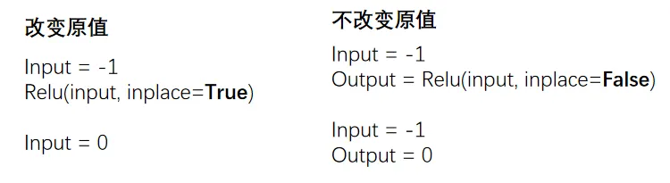

## 1.1.2.4 Ⅳ 其他层

> 「Transformer Layers」 特定的网络结构
>
> 「Sparse Layers」 特定的网络结构，其中的 Embedding 用于自然语言处理
>
> 「Linear Layers」 用的较多，即 全连接层
> 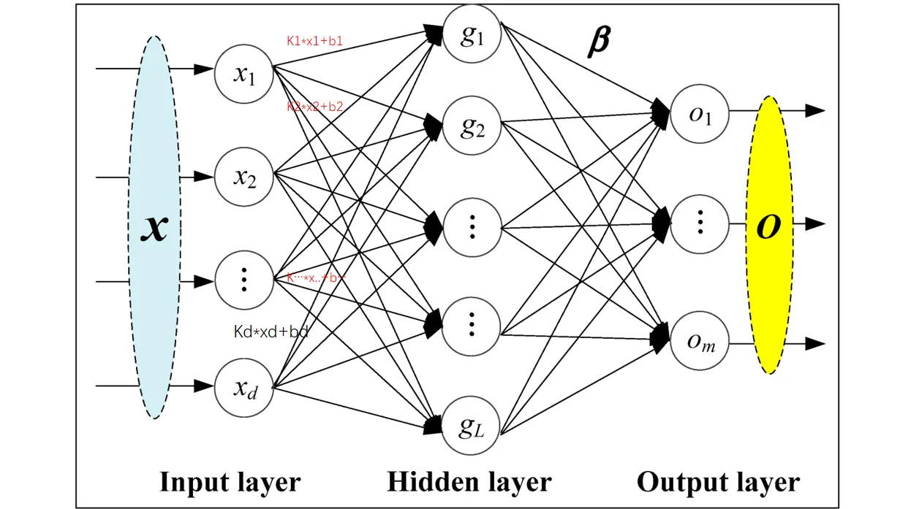

> nn\_linear.py

```python
import torch  

import torchvision  

from torch import nn  

from torch.nn import Linear  

from torch.utils.data import DataLoader  

  

dataset = torchvision.datasets.CIFAR10("./data",  

                                       train=False,  

                                       transform=torchvision.transforms.ToTensor(),  

                                       download=True)  

  

dataloader = DataLoader(dataset, batch_size=64)  

  

class Tudui(nn.Module):  

    def __init__(self):  

        super().__init__()  

        self.linear1 = Linear(196608, 10)  

  

    def forward(self, input):  

        output = self.linear1(input)  

        return output  

  

tudui = Tudui()  

  

for data in dataloader:  

    imgs, targets = data  

    print(imgs.shape) # torch.Size([64, 3, 32, 32])  

  

    # flatten 展平成一行  类似于reshape(1,1,1,-1),但是维度不一样哦
	# 注意, torch.flatten和下面代码中的nn.Flatten()不一样
    output = torch.flatten(imgs)  

    print(output.shape) # torch.Size([196608])  注意:变成一维的了
  

    output = tudui(output)  

    print(output.shape)
    ## 输出torch.Size([10])
```

> **Note:**
> 注意点:
>
> `torch.flatten(imgs)`，它**直接把所有图片合成了一个一维向量**，丢掉了 batch 信息。模型只能输出 `torch.Size([10])
>
> `nn.Flatten()`，只展平单张图片，**不会丢失 batch**，所以每一张图片都能独立得到 10 维预测，输出就是 `torch.Size([64,10])`

## 1.1.3 Sequential

> Sequential 主要是方便代码的编写，使代码更加简洁

根据下图搭建神经网络：判断一个图的类别（最后输出为十个类别，最后进行判断）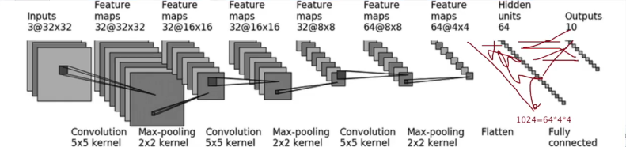

> nn\_seq.py

> 未使用 sequential
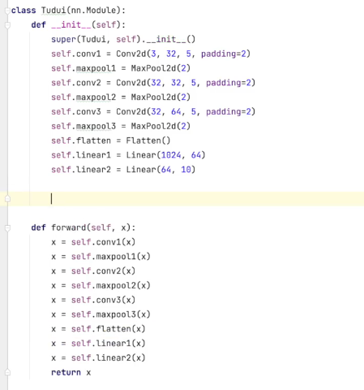

> 使用 sequential 统一管理中间层

```python
import torch  

from torch import nn  

from torch.nn import Conv2d, MaxPool2d, Flatten, Linear, Sequential  

from torch.utils.tensorboard import SummaryWriter  

  

class Tudui(nn.Module):  

    def __init__(self):  

        super(Tudui, self).__init__()  

        self.model1 = Sequential(  

            Conv2d(3, 32, 5, padding=2),##对照以上那个图  

            MaxPool2d(2),  ##池化

            Conv2d(32, 32, 5, padding=2),  

            MaxPool2d(2),  

            Conv2d(32, 64, 5, padding=2),  

            MaxPool2d(2),  

            Flatten(),  ## 展平成一维

            Linear(1024, 64),  

            Linear(64, 10)  

        )  

  

    def forward(self, x):  

        x = self.model1(x)  

        return x  

  

tudui = Tudui()  

print(tudui)  

  

# 检查网络  

input = torch.ones((64, 3, 32, 32))  

output = tudui(input)  

print(output.shape)  ## 输出 torch.Size([64,10])

  
# tensorboard中的add_graph 查看神经网络的流程图  

writer = SummaryWriter("logs")  

writer.add_graph(tudui, input)  

writer.close()
```

# 1.2 损失&优化

## 1.2.1 损失函数

> 损失函数（Loss Function）用于衡量模型的「预测输出」与「实际标签」之间的差异或者误差
>
> 损失越小越好，根据 loss 调整参数，以减小损失 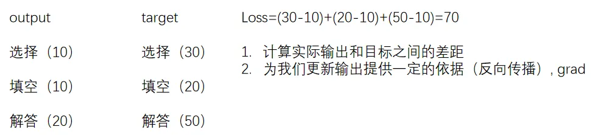

```python
# 计算output和target之差的「绝对值」

nn.L1Loss()

# 计算output和target之差的「均方差」

nn.MSELoss()
```

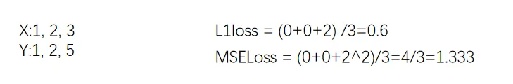

```python
# 交叉熵损失函数（Cross-Entropy Loss Function）是在分类问题中经常使用的一种损失函数

# 当分类预测正确时，损失要比较小，即\`-x[class]\`相比右边的项应较大

nn.CrossEntropyLoss()
```

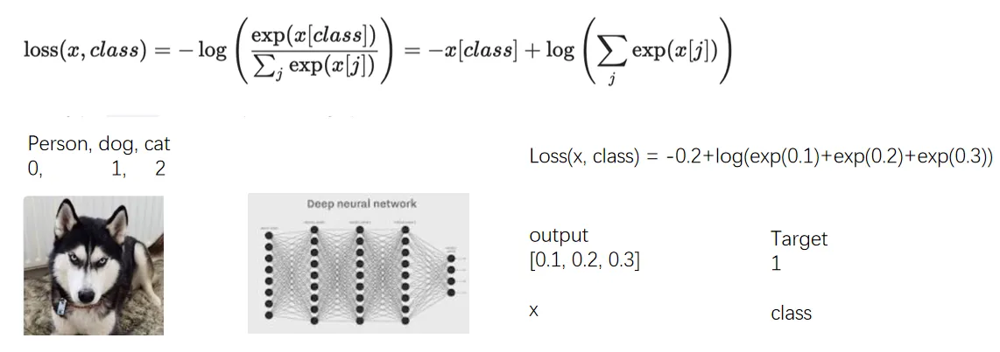

> nn\_loss.py

```python
import torch  

from torch.nn import L1Loss  

from torch import nn  

  

inputs = torch.tensor([1, 2, 3], dtype=torch.float32)  

targets = torch.tensor([1, 2, 5], dtype=torch.float32)  

  

inputs = torch.reshape(inputs, (1, 1, 1, 3))  

targets = torch.reshape(targets, (1, 1, 1, 3))  

  

# 01 L1Loss  

loss = L1Loss(reduction='sum') # mean or sum  选择计算方式

result = loss(inputs, targets)  

print(result)  

  

# 02 MSELoss  

loss_mse = nn.MSELoss()  

result_mse = loss_mse(inputs, targets)  

print(result_mse)  

  

# 03 CrossEntropyLoss  

x = torch.tensor([0.1, 0.2, 0.3])  

y = torch.tensor([1])  

x = torch.reshape(x, (1, 3))  
##`CrossEntropyLoss` 期望 x 的形状是 (1, 3)（一个样本，三个类别），y 的形状是 (1,)
## 必须将 x 的形状由 (3,) 变为 (1, 3)

loss_cross = nn.CrossEntropyLoss()  

result_cross = loss_cross(x, y)  

print(result_cross)
```

## 1.2.2 反向传播

> 前向传播：将训练集数据输入到 NN 的「输入层」，经过「隐藏层」，最后到达「输出层」并输出结果
>
> 反向传播：计算估计值与实际值之间的误差，并将误差从「输出层」向「隐藏层」反向传播，直至「输入层」

> nn\_loss\_network.py

```python
import torchvision  

from torch import nn  

from torch.nn import Sequential, Conv2d, MaxPool2d, Flatten, Linear  

from torch.utils.data import DataLoader  

  

dataset = torchvision.datasets.CIFAR10("./data",  

                                       train=False,  

                                       transform=torchvision.transforms.ToTensor(),  

                                       download=True)  

  

dataloader = DataLoader(dataset, batch_size=1)  

  

class Tudui(nn.Module):  

    def __init__(self):  

        super(Tudui, self).__init__()  

        self.model1 = Sequential(  

            Conv2d(3, 32, 5, padding=2),  

            MaxPool2d(2),  

            Conv2d(32, 32, 5, padding=2),  

            MaxPool2d(2),  

            Conv2d(32, 64, 5, padding=2),  

            MaxPool2d(2),  

            Flatten(),  

            Linear(1024, 64),  

            Linear(64, 10)  

        )  

  

    def forward(self, x):  

        x = self.model1(x)  

        return x  

  

loss = nn.CrossEntropyLoss()  

tudui = Tudui()  

for data in dataloader:  

    imgs, targets = data  

    outputs = tudui(imgs)  

    result_loss = loss(outputs, targets)  

    # 反向传播 计算梯度  

    result_loss.backward()  

    print("ok")
```

## 1.2.3 优化器

> **更新参数 减少损失**
>
> 反向传播（backward）–> 计算出梯度（grad）–> 根据梯度和学习率更新参数 –> 减小 loss

优化器的种类比较多，常用的就是 SGD（随机梯度下降）

不同优化器的参数列表不同，一般设置「parameters」和 l「lr」这两个参数，其他默认 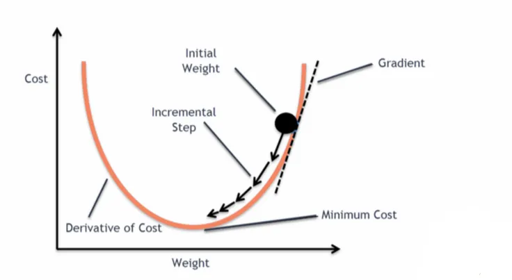

> nn\_optim.py

```python
import torch  

import torchvision  

from torch import nn  

from torch.nn import Sequential, Conv2d, MaxPool2d, Flatten, Linear  

from torch.optim.lr_scheduler import StepLR  

from torch.utils.data import DataLoader  

  

dataset = torchvision.datasets.CIFAR10("./data",  

                                       train=False,  

                                       transform=torchvision.transforms.ToTensor(),  

                                       download=True)  

  

dataloader = DataLoader(dataset, batch_size=1)  

  

class Tudui(nn.Module):  

    def __init__(self):  

        super(Tudui, self).__init__()  

        self.model1 = Sequential(  

            Conv2d(3, 32, 5, padding=2),  

            MaxPool2d(2),  

            Conv2d(32, 32, 5, padding=2),  

            MaxPool2d(2),  

            Conv2d(32, 64, 5, padding=2),  

            MaxPool2d(2),  

            Flatten(),  

            Linear(1024, 64),  

            Linear(64, 10)  

        )  

  

    def forward(self, x):  

        x = self.model1(x)  

        return x  

  

loss = nn.CrossEntropyLoss()  

tudui = Tudui()  

  

# 优化器 SGD（随机梯度下降）  

optim = torch.optim.SGD(tudui.parameters(), lr=0.01) ## lr学习率，太大不稳定，太小收敛慢  
##tudui.parameters() 的作用：这个方法会自动遍历 `Tudui` 网络中所有子模块（比如 `Conv2d` 和 `Linear` 层），收集这些层的所有可训练参数，返回到torch.optim.SGD


for epoch in range(20):  ## 进行多轮学习

    running_loss = 0.0  

    for data in dataloader:  

        imgs, targets = data  

        outputs = tudui(imgs)  

        result_loss = loss(outputs, targets)  

  

        optim.zero_grad() # 把上一步的梯度清零，否则会累加  

        result_loss.backward()  

        optim.step() # 对weight参数进行更新  

  

        running_loss = running_loss + result_loss  

    print(running_loss)
```
