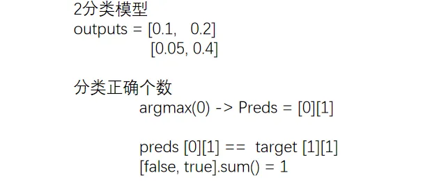
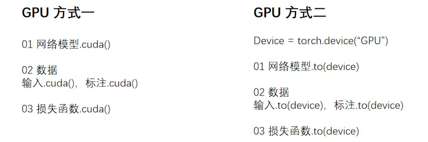

# 第 04 讲 炼丹流程📝

# 1.1 模型操作

## 1.1.1 使用&修改

> torchvision.models 有分类、语义分割、目标检测等，本次讲分类模型 VGG
>
> 最常用的为 VGG16 和 VGG19，VGG16 的数据集 ImageNet 需安装「scipy」

> model\_pretrained.py

```python
import torchvision  

from torch import nn  

  

# VGG16 对应的 ImageNet数据集 由于数据集过大选择放弃  

# train_data = torchvision.datasets.ImageNet("./data_image_net",  

#                                                 split='train',  

#                                                 download=True,  

#                    transform=torchvision.transforms.ToTensor())  

  

# 01 使用  

vgg16_false = torchvision.models.vgg16(pretrained=False) # 初始参数  

vgg16_true = torchvision.models.vgg16(pretrained=True)   # 训练好的  

  

print(vgg16_true) ## 查看网络模型架构 

  

train_data = torchvision.datasets.CIFAR10('./data',  

                                          train=True,  

                                          transform=torchvision.transforms.ToTensor(),  

                                          download=True)  

  

# 02 修改方式  

# (1) 加线性层  

print(vgg16_true)  

vgg16_true.classifier.add_module('add_linear', nn.Linear(1000, 10))  

print(vgg16_true)  

  

# (2) 直接修改  

print(vgg16_false)  

vgg16_false.classifier[6] = nn.Linear(4096, 10)  

print(vgg16_false)
```

## 1.1.2 保存&加载

> 训练好的模型需要进行保存，以备后续加载使用

> model\_save.py

```python
import torch  

import torchvision  

from torch import nn  

  

vgg16 = torchvision.models.vgg16(pretrained=False)  ##不要预训练

  

  

# 01 保存方式  

# (1) 模型参数 + 模型结构  

torch.save(vgg16, "vgg16_method1.pth")  

  

# (2) 模型参数（官方推荐）  
## .state_dict()是将网络模型保存成Python中字典形式
torch.save(vgg16.state_dict(), "vgg16_method2.pth")  

  

# 02 自定义模型  

class Tudui(nn.Module):  

    def __init__(self):  

        super(Tudui, self).__init__()  

        self.conv1 = nn.Conv2d(3, 64, kernel_size=3)  

  

    def forward(self, x):  

        x = self.conv1(x)  

        return x  

  

tudui = Tudui()  

torch.save(tudui, "tudui_method1.pth")
```

> 自定义模型保存后加载，记得要 「导入」

> model\_load.py

```python
import torch  

import torchvision  

  

# 01 加载方式  

# (1) 加载 模型参数 + 模型结构  torch.load

model = torch.load("vgg16_method1.pth")  

print(model)  

  

# (2) 加载 模型参数  (恢复以字典形式保存的模型的结构) .load_state_dict(torch.load())

vgg16 = torchvision.models.vgg16(pretrained=False)  

vgg16.load_state_dict(torch.load("vgg16_method2.pth"))  

print(vgg16)  

  

# 02 自定义模型 (有加载陷阱)  

# 需要复制过来 or 导入

## 方式1. 复制过来  (但是不需要tudui = Tudui())
class Tudui(nn.Module):  

    def __init__(self):  

        super(Tudui, self).__init__()  

        self.conv1 = nn.Conv2d(3, 64, kernel_size=3)  

  

    def forward(self, x):  

        x = self.conv1(x)  

        return x

## 方式2. 从上面model_save.py文件导入所有类、函数和变量
from model_save import *  

model = torch.load('tudui_method1.pth')  

print(model)
```

# 1.2 模型训练

> train.py

```python
import torchvision  

from torch.utils.data import DataLoader  

from torch.utils.tensorboard import SummaryWriter  

from model import *  #用下方单独创建的model文件(这样比较规范)

  

# 01 准备数据集  

train_data = torchvision.datasets.CIFAR10(root="./data",  

                                          train=True,  

                                          transform=torchvision.transforms.ToTensor(),  

                                          download=True)  

test_data = torchvision.datasets.CIFAR10(root="./data",  

                                         train=False,  

                                         transform=torchvision.transforms.ToTensor(),  

                                         download=True)  

# length 查看长度

train_data_size = len(train_data)  

test_data_size = len(test_data)  

print("训练数据集的长度为：{}".format(train_data_size))  

print("测试数据集的长度为：{}".format(test_data_size))  

  

# 02 利用 DataLoader 加载数据集 

train_dataloader = DataLoader(train_data, batch_size=64)  

test_dataloader = DataLoader(test_data, batch_size=64)  

  

# 03 创建网络模型  

tudui = Tudui()  

  

# 04 损失函数  

loss_fn = nn.CrossEntropyLoss()  

  

# 05 优化器  

learning_rate = 1e-2 # 代表0.01  

optimizer = torch.optim.SGD(tudui.parameters(), lr=learning_rate)  

  

# 06 设置训练网络的一些参数  

total_train_step = 0 # 记录训练的次数  

total_test_step = 0 # 记录测试的次数  

epoch = 10 # 训练的轮数  

  

# 添加tensorboard  可视化查看信息

writer = SummaryWriter("logs")  


for i in range(epoch):  

    print("-------第 {} 轮训练开始-------".format(i+1))  

  

    """  

        仅对一部分网络层有作用， 如Dropout、BatchNorm层  

        tudui.train()   设置成训练模式（可选）  

        tudui.eval()    设置成测试模式（可选）  

    """    

    # 07 训练步骤开始  

    tudui.train()  

    for data in train_dataloader:  

        imgs, targets = data  

        outputs = tudui(imgs)  

        loss = loss_fn(outputs, targets)  

  

        # 优化器 进行一次 优化模型  

        optimizer.zero_grad()  ##先梯度清零

        loss.backward()  

        optimizer.step()  


        total_train_step = total_train_step + 1  

        if total_train_step % 100 == 0:  ## 满一百打印一次记录

            print("训练次数：{}, Loss: {}".format(total_train_step, loss.item()))  
            ## 这里加.item 是让直接输出显示数值(转为标量值int/float),不显示类型

            writer.add_scalar("train_loss", loss.item(), total_train_step)  

                                           

    # 08 测试步骤开始 (使用测试集啦)

    tudui.eval()  

    total_test_loss = 0  

    total_accuracy = 0  

    with torch.no_grad(): # 因为只需要测试，不需要反传梯度  

        for data in test_dataloader:  ## 使用测试数据集

            imgs, targets = data  

            outputs = tudui(imgs)  

  

            loss = loss_fn(outputs, targets)  

            total_test_loss = total_test_loss + loss.item()  

  

            accuracy = (outputs.argmax(1) == targets).sum() # argmax -> 正确个数  argmax(1) ->横向对比

            total_accuracy = total_accuracy + accuracy  

  

    print("整体测试集上的Loss: {}".format(total_test_loss))  

    print("整体测试集上的正确率: {}".format(total_accuracy/test_data_size))  

    writer.add_scalar("test_loss", total_test_loss, total_test_step)  

    writer.add_scalar("test_accuracy", total_accuracy/test_data_size, total_test_step)  

    total_test_step = total_test_step + 1  

  
# 保存模型
    torch.save(tudui, "tudui_{}.pth".format(i))  
	##官方保存方式 torch.save(tudui.state_dict(),"tudui_{}.pth".format(i))
		##.state_dict()转换为字典型
		
    print("模型已保存")  

  

writer.close()
```

> model.py

```python
import torch  

from torch import nn  

  

# 搭建神经网络  

class Tudui(nn.Module):  

    def __init__(self):  

        super(Tudui, self).__init__()  

        self.model = nn.Sequential(  

            nn.Conv2d(3, 32, 5, 1, 2),  

            nn.MaxPool2d(2),  

            nn.Conv2d(32, 32, 5, 1, 2),  

            nn.MaxPool2d(2),  

            nn.Conv2d(32, 64, 5, 1, 2),  

            nn.MaxPool2d(2),  

            nn.Flatten(),  

            nn.Linear(64*4*4, 64),  

            nn.Linear(64, 10)  

        )  

  

    def forward(self, x):  

        x = self.model(x)  

        return x  

  

# main函数  ()

if __name__ == '__main__':  

  
## 测试网络模型的正确性
    tudui = Tudui()  

    input = torch.ones((64, 3, 32, 32))  

    output = tudui(input)  

    print(output.shape)
```

> 正确率是分类问题比较特有的指标，计算正确率的方法如下



> argmax() 函数.py

```python
import torch  

  

# item()函数  

# 从只包含单个元素的张量中提取Python数值，将张量转换为标量值  

a = torch.tensor(5)  

print(a)  

print(a.item())  

  

# argmax()函数  

# 0纵向，1横向  

outputs = torch.tensor([[0.1,0.2],  

                        [0.05,0.4]])  

print(outputs.argmax(0)) # 纵向对比  

print(outputs.argmax(1)) # 横向对比
```

# 1.3 GPU



> train\_gpu\_1.py

```python
import torch  

import torchvision  

from torch import nn, cuda  

from torch.utils.data import DataLoader  

from torch.utils.tensorboard import SummaryWriter  

  

# 01 准备数据集

# ···

# ···

  

# 03 创建网络模型  

"""  

使用GPU要做的修改  

    01 网络模型  

    02 数据  

    03 损失函数  

"""  

tudui = Tudui()  

if cuda.is_available():  

    tudui.cuda()  ##将网络模型转移到cuda上

  

# 04 损失函数  

loss_fn = nn.CrossEntropyLoss()  

if cuda.is_available():  

    loss_fn = loss_fn.cuda()  

# ···

# ···

    # 07 训练步骤开始   

    for data in train_dataloader:  

        imgs, targets = data  

  

        if cuda.is_available():  

            imgs = imgs.cuda()  

            targets = targets.cuda()  

# ···

# ···

    # 08 测试步骤开始  

        for data in test_dataloader:  

            imgs, targets = data  

  

            if cuda.is_available():  

                imgs = imgs.cuda()  

                targets = targets.cuda()
```

> train\_gpu\_2.py

```python
import torch  

import torchvision  

from torch import nn, cuda  

from torch.utils.data import DataLoader  

from torch.utils.tensorboard import SummaryWriter  

  

"""  

单显卡  

Torch.device(“cuda”)  

Torch.device(“cuda:0”)  

  

多显卡-第2张  

Torch.device(“cuda:1”)  

"""  

# 定义训练的设备  

device = torch.device("cuda" if torch.cuda.is_available() else "cpu")  

  

# 01 准备数据集  

# ···

# ···

# 03 创建网络模型  

"""  

使用GPU要做的修改  

    01 网络模型  

    02 数据  

    03 损失函数  

"""  

tudui = Tudui()  

tudui.to(device)  

  

# 04 损失函数  

loss_fn = nn.CrossEntropyLoss()  

loss_fn.to(device)  

# ···

# ···

    # 07 训练步骤开始  

    for data in train_dataloader:  

        imgs, targets = data  

  

        imgs = imgs.to(device)  

        targets = targets.to(device)  

# ···

# ···

    # 08 测试步骤开始  

        for data in test_dataloader:  

            imgs, targets = data  

  

            imgs = imgs.to(device)  

            targets = targets.to(device)
```

# 1.4 验证

> 本节加载模型，选择导入 model 文件中模型的方式，不再复制代码

> test.py

```python
import torch  

import torchvision  

from PIL import Image  

from torch import nn  

from model import *  

  

image_path = "./imgs/dog.png"  

image = Image.open(image_path)  

"""  

png格式是RGBA四个通道，需要转为RGB颜色通道  

视频可以运行是因为不同截图软件保留的通道数是不一样的  

"""  

image = image.convert('RGB')  

transform = torchvision.transforms.Compose([  
					
					    torchvision.transforms.Resize((32, 32)),  
					
					    torchvision.transforms.ToTensor()  

											])  

image = transform(image)  

print(image.shape)  

  

#  01 CPU环境  

# 先注释,因为不用CPU  model = torch.load("tudui_0.pth")  

  

# 02 CPU环境 验证 GPU环境下训练的模型  

model = torch.load("tudui_29_gpu.pth",map_location=torch.device('cpu'))  
								## map_location 对应到相应的设备上(映射)

  
# 开始验证

image = torch.reshape(image, (1, 3, 32, 32))  

model.eval()   ## 设置为测试类型(符合规范)

with torch.no_grad():  

    output = model(image)  

print(output)  

print(output.argmax(1)) # 横向
```
