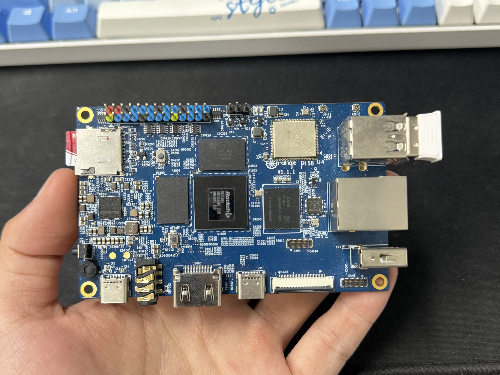

# 1.数据标注

- 通过 labelimg 软件进行图片数据标注。
- 深入解析 LabelImage：图像标注工具的全面指南 -CSDN 博客
- 提前 predefined_classes.txt 文本中修改不同类别的数据。

# 2.模型训练

- 以 RKNN 系列模型为例，训练一个 yolov7 的目标检测模型。
- 通过 SSH 进入计算服务器的 Docker 中，按照 readme 文件进行模型训练。
- <http://10.1.0.100:9000/> user:cnb keyword:cnb423423
- docker attach yolov7-gzq
- 通常情况下将标注好的数据放入 yolov7-rknn/datasets 文件夹中，修改
yolov7-rknn/data 文件夹中的数据集配置文件，在 yolov7-rknn 文件夹
中执行 python train.py --data ./data/XXX.yaml --workers 8 --batch 64
--device 0 --epoch 300 进行训练
- 执行后运行 python export.py --rknpu rk3588 --
weight ./runs/train/expXX/weights/best.pt 导出 onnx 文件以供转换。

# 3.模型转换与部署

- 参照 airockchip/rknn-toolkit2 at v1.5.2 进行模型转换。
- 将转换好的模型拷贝至部署代码的 model/RK3588 的文件夹中，同
时参照 model 文件夹中的文本编写类别信息。
- 修改 include/postprocess.h 中 OBJ_CLASS_NUM（类别数） 和
src/postprocess.cc 的 LABEL_NALE_TXT_PATH（类别信息文本的地
址）。
- 重新执行编译脚本编译代码。
- 按照 install.md 文件执行，并使用 orangepi-config 使能串口 0 和串
口 1。
