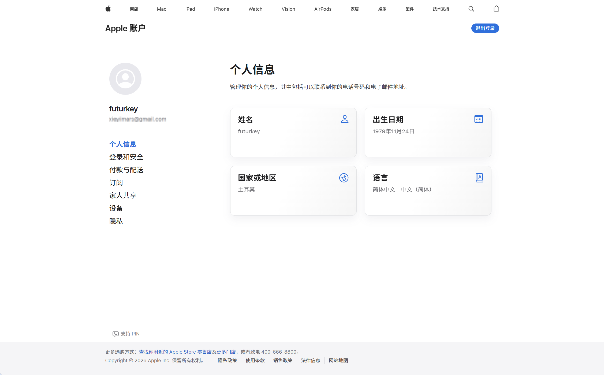
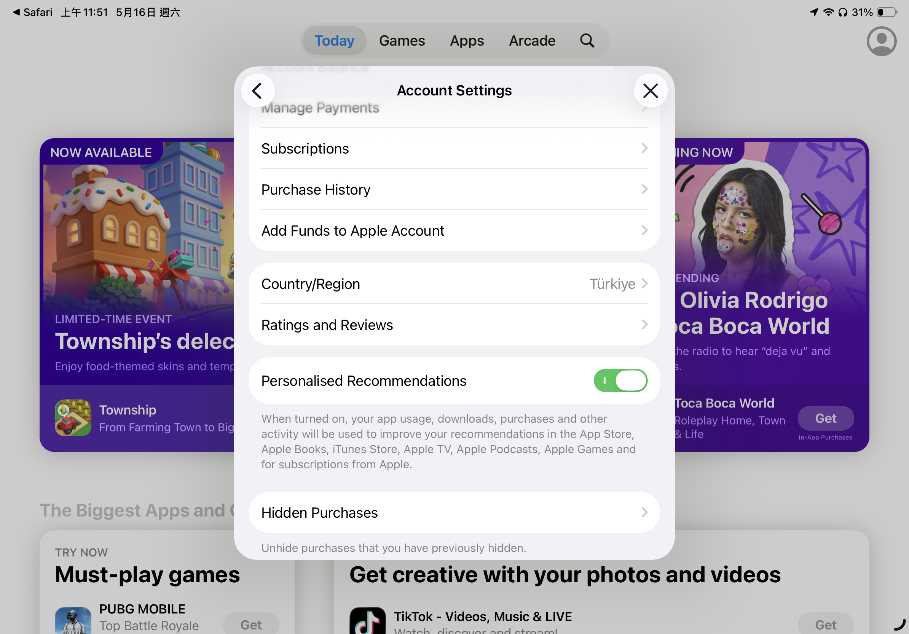
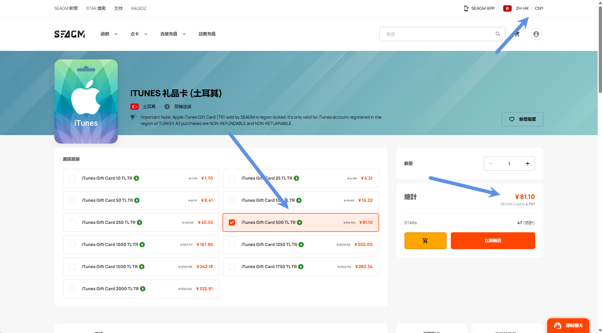
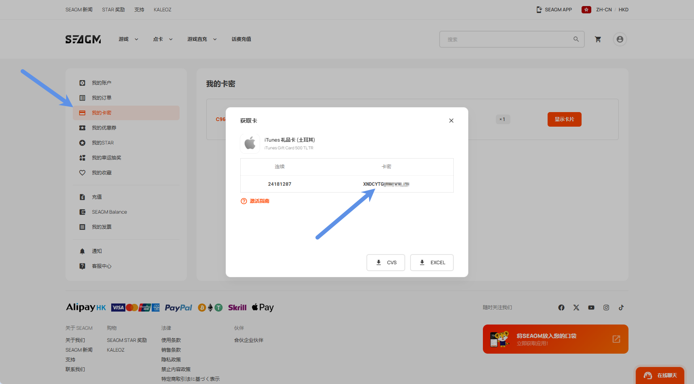
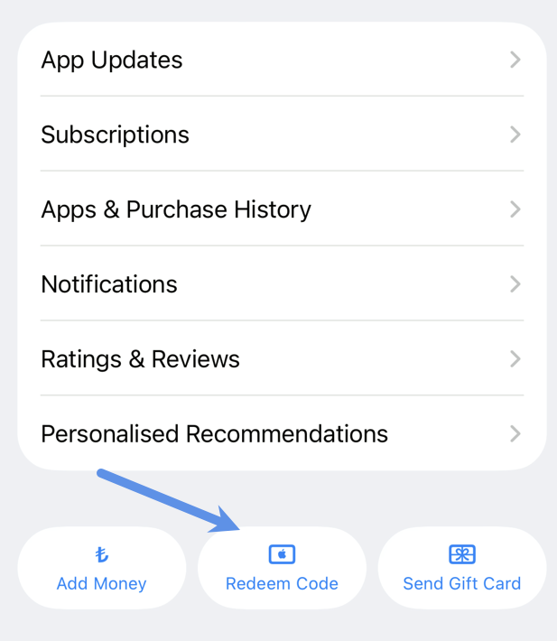
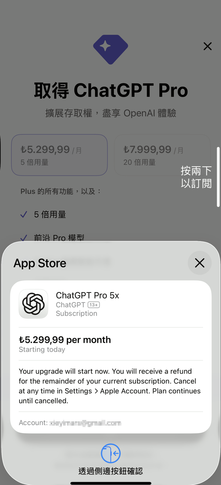
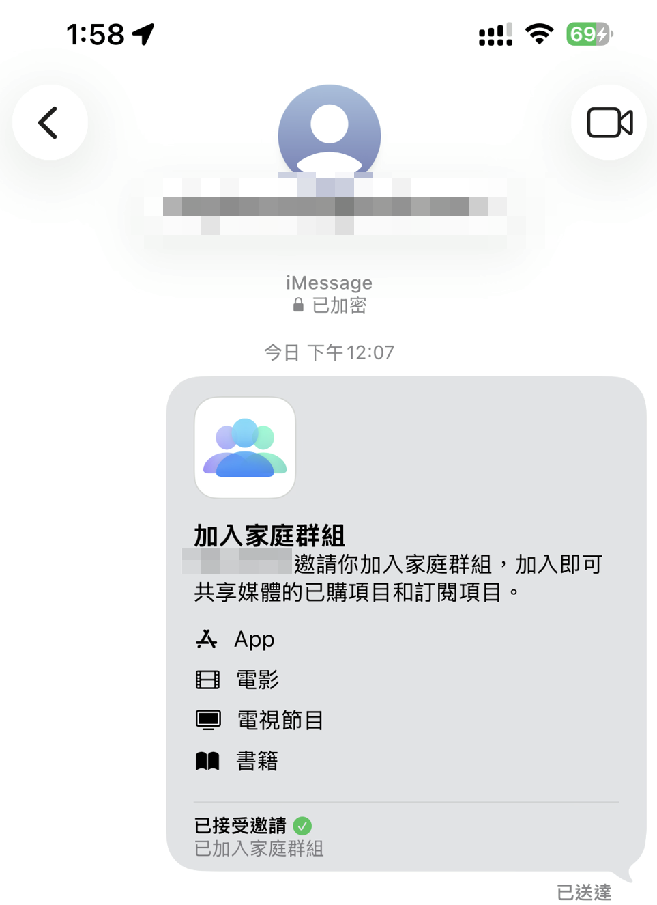

最近重新折腾了一遍土耳其区 Apple ID，并成功完成：

- 注册土耳其 Apple ID
- 购买土区苹果礼品卡
- 充值 Apple 余额
- 通过 iPhone 成功订阅 ChatGPT Plus
- **附：** 将土区账号加入中国区 Apple 家庭（以备后续共享土区的 iCloud 订阅）

整个流程比想象中稳定很多，所以这里把完整过程整理成一篇教程。

这篇文章主要适用于：

- 想低价订阅 GPT Plus 的用户
- 想长期维护土区 Apple 生态的用户
- 后期可能需要土区 iCloud / Apple One / Arcade 等订阅的用户

> 注意：本文仅记录个人实操过程与经验。

---

# 为什么选择土耳其区？

相比国区、美区等地区：

- 土耳其区订阅价格长期偏低
- Apple 礼品卡获取方便
- GPT Plus 可直接通过 App Store 内购
- 后期还能扩展更多 Apple 服务

而且：

> GPT 登录账号不需要是土区账号。

真正需要土区的，其实只是：

- 用于支付的 Apple ID

所以实际使用体验几乎没有影响。你可以继续保留注册好的 GPT 账号。

---

# 前期准备

开始之前，需要准备以下内容。

## 1. 一个全新的邮箱

要求：

- 没注册过 Apple ID
- 推荐 Gmail / Outlook

---

## 2. 一个手机号

最好：

- 没绑定过 Apple ID

但实际上：

- 国内手机号也能正常注册
- 即便绑定过 Apple ID，大多数情况下也能用

属于“看运气”的部分。

---

## 3. 一份土耳其地址信息

这里推荐直接使用在线生成器：

<https://1ktools.com/zh-cn/tools/developer/turkey-address-generator>

随机生成一份即可。

后续：

- 礼品卡购买
- Apple 付款信息

都可能会用到。

---

## 4. 一台 Apple 设备

支持：

- iPhone
- iPad
- Mac

但这里有一个重点：

> GPT 订阅的最终支付必须使用移动设备完成。

也就是说：

- Mac 可以注册
- Mac 可以登录
- 但不能完成 App Store 内购支付

所以最终还是需要：

- iPhone
- 或 iPad

---

# 一、注册土耳其 Apple ID

## 1. 打开 Apple 官网

进入：

<https://account.apple.com/>

建议：

- 使用浏览器无痕模式
- 是否开启代理无所谓

我测试：

- 挂代理可以
- 不挂也可以

---

## 2. 创建 Apple 账户

进入后点击：

> 创建你的 Apple 账户

填写时注意：

- 国家选择：土耳其
- 姓名：可使用土耳其地址生成器里的名字
- 出生日期：大于 18 岁即可
- 邮箱：新邮箱
- 手机号：国内手机号即可

---

## 3. 验证信息

填写验证码后，正常情况下就能完成注册。

这里会看到：

- 国家和地区已经显示为土耳其

但：

> 这并不意味着 App Store 已经真正切换到土区。

这是很多人容易踩坑的地方。

---



---

# 二、真正切换 App Store 到土耳其区（关键步骤）

很多人：

- 明明注册的是土区账号
- 结果登录 App Store 后又跳回中国区

原因是：

> App Store 地区并没有真正重置。

这里推荐使用：

## 使用 App Store 地区跳转链接（强烈推荐）

| 地区   | 快捷跳转链接                                                                                     |
| ---- | ------------------------------------------------------------------------------------------ |
| 美国   | `itms-apps://itunes.apple.com/WebObjects/MZStore.woa/wa/resetAndRedirect?dsf=143441&cc=us` |
| 日本   | `itms-apps://itunes.apple.com/WebObjects/MZStore.woa/wa/resetAndRedirect?dsf=143462&cc=jp` |
| 韩国   | `itms-apps://itunes.apple.com/WebObjects/MZStore.woa/wa/resetAndRedirect?dsf=143466&cc=kr` |
| 香港   | `itms-apps://itunes.apple.com/WebObjects/MZStore.woa/wa/resetAndRedirect?dsf=143463&cc=hk` |
| 尼日利亚 | `itms-apps://itunes.apple.com/WebObjects/MZStore.woa/wa/resetAndRedirect?dsf=143561&cc=ng` |
| 土耳其  | `itms-apps://itunes.apple.com/WebObjects/MZStore.woa/wa/resetAndRedirect?dsf=143480&cc=tr` |
| 埃及   | `itms-apps://itunes.apple.com/WebObjects/MZStore.woa/wa/resetAndRedirect?dsf=143516&cc=eg` |
| 印度   | `itms-apps://itunes.apple.com/WebObjects/MZStore.woa/wa/resetAndRedirect?dsf=143467&cc=in` |
| 阿根廷  | `itms-apps://itunes.apple.com/WebObjects/MZStore.woa/wa/resetAndRedirect?dsf=143505&cc=ar` |

---

## 1. 退出当前 App Store 账号

路径：

> App Store → 头像 → 退出登录

注意：

- 这里只退出 App Store
- 不需要退出 iCloud

---

## 2. 使用 Safari 打开土区跳转链接

直接复制到 Safari：

```text
itms-apps://itunes.apple.com/WebObjects/MZStore.woa/wa/resetAndRedirect?dsf=143480&cc=tr
```

Safari 会自动跳转到：

- 土耳其区 App Store

---

## 3. 直接登录刚注册的土区账号

登录后检查：

- App Store 地区是否为 Turkey（土耳其）

确认无误后：

> 说明土区 Apple ID 已真正注册成功。

---



---

# 三、购买土耳其 Apple 礼品卡

接下来需要给账号充值。

这里推荐两种方式：

## 方案一：正规虚拟卡平台（推荐）

推荐：

- <https://www.oyunfor.com/>
- <https://www.seagm.com/>

其中：

- SEAGM 支持支付宝
- 对国内用户更方便

所以我这里直接使用 SEAGM。

---

## 方案二：国内二手平台

比如：

- 小黄鱼
- 其他电商平台

不太推荐。

原因：

- 来源不稳定
- 容易涉及灰产卡
- 有一定封号风险

---

# 四、购买礼品卡并充值

## 1. 使用支持支付宝的 SEAGM 购买礼品卡

建议：

- 网站语言切换中文
- 货币切换人民币

这样可以直接：

- 支付宝扫码付款

---



---

## 2. 获取礼品卡代码

付款完成后：

> 我的卡密 → 显示卡片

即可看到兑换码。

---



---

## 3. App Store 兑换礼品卡

路径：

> App Store → 头像 → 最底部 → 兑换礼品卡或代码

输入礼品卡代码即可。

充值成功后：

- Apple 余额会显示对应里拉金额

---



---

# 五、关于付款信息：不需要提前选择 None

这里需要特别说明一个很多教程都会提到的问题。

网上不少教程会说：

> 注册完土区 Apple ID 后，需要先去添加付款信息，并且付款方式选择 None。

但实际操作中，经常会遇到：

- 找不到 None 选项
- 无法选择 None
- 页面要求补充付款信息
- 填完后仍然无法保存

其实这一步完全可以不用提前处理。

我的实际流程是：

> 不需要注册完 Apple ID 后马上去设置付款方式，也不需要纠结有没有 None。

只需要先完成：

- 土区 Apple ID 注册
- App Store 切换到土耳其区
- 礼品卡充值

然后直接打开 ChatGPT App 订阅 Plus。

当你点击订阅时，系统会自动弹出付款信息填写页面。

这时候不需要选择 None，只需要简单填写土耳其地址信息即可。

地址可以继续使用前面生成的土耳其地址。

填写完成后，系统会直接从 Apple ID 余额中扣款完成订阅。

---

# 六、订阅 ChatGPT Plus

充值完成后：

直接打开 ChatGPT App。

然后：

> 设置 → Upgrade → Subscribe

即可完成订阅。

如果系统弹出付款信息页面：

- 不需要选择 None
- 不需要绑定银行卡
- 只需要填写土耳其地址信息
- 确认后会优先使用 Apple ID 余额扣款

---

这里需要再次强调：

> GPT 登录账号不需要是土区账号。

真正需要土区的：

只是支付 Apple ID。

---

我这里之前已经订阅过 Plus，所以用 Pro 做演示。

---



---

# 七、将土区账号加入中国区 Apple 家庭（附加功能）

这一部分：

## 和 GPT Plus 共享无关

这里真正的意义是：

> 后续可以共享土区 iCloud / Apple One 等订阅服务。

---

## 方案：将土区账号加入中国区 Apple 家庭

正常邀请会提示：

> 不能将其他地区账号加入家庭。

所以这里推荐两个稳定方法。

---

## 方法一：隔空投送邀请

在中国区家庭管理员设备上：

进入：

> 设置 → Apple ID → 家人共享

然后：

- 点击右上角添加账号
- 选择【邀请他人】
- 使用【隔空投送】

---

此时：

另一台登录土区账号的设备：

开启：

> 允许任何人隔空投送

两台设备靠近后：

- 会自动弹出邀请

按提示操作即可。

---

## 方法二：iMessage 邀请（更稳定）

步骤基本一样。

区别是：

在邀请方式中选择：

> 信息（iMessage）

然后：

- 输入土区 Apple ID 邮箱

即可发送邀请。

---

这个方法实际上更稳定。

因为：

- 隔空投送偶尔失败
- iMessage 成功率更高

---



---

# 最后总结

至此，你已经完成了：

- 土耳其 Apple ID 注册
- App Store 真正切换土区
- 土区礼品卡购买
- Apple 余额充值
- GPT Plus 订阅
- 土区账号加入中国区家庭

整个流程目前依然稳定可用。

如果你后续还准备：

- 开通土区 iCloud+
- Apple One
- Apple Music
- Arcade

那么提前维护一个长期稳定的土区 Apple ID，其实非常值得。

---

# 常见问题 FAQ

## Q1：必须使用代理吗？

不必须。

我测试：

- 开代理可以
- 不开也能注册

---

## Q2：为什么 Mac 无法支付？

因为 GPT Plus 的 App Store 内购：

目前只能通过移动端完成。

---

## Q3：GPT 账号必须是土区吗？

不需要。

土区只负责：

- Apple 支付

GPT 账号本身没有限制。

---

## Q4：注册完土区 Apple ID 后，必须先添加付款方式并选择 None 吗？

不需要。

很多教程会要求提前设置付款方式，并选择 None。

但实际操作中：

- None 经常不出现
- 可能无法保存
- 容易卡在付款信息页面

更简单的做法是：

> 注册完成后不用管付款方式，直接充值礼品卡，然后去 ChatGPT App 订阅。

订阅时系统会自动弹出付款信息填写页面。

这时候只需要填写土耳其地址信息即可，不需要选择 None，也不需要绑定银行卡。

---

## Q5：家庭共享是共享 GPT Plus 吗？

不是。

这里只是：

- Apple 家庭共享

主要用于后续：

- iCloud+
- Apple One
- Apple Music 等服务共享。

---

## Q6：土区 Apple ID 会封号吗？

只要：

- 不使用来路不明的黑卡
- 不频繁切换地区
- 不进行异常退款
- 长期稳定使用

一般都比较稳定。

本文使用的是礼品卡充值方式，相对也更加安全。
