# VSCode 优化使用体验篇（设置 | 插件）

> 众所周知，vscode 是一个非常好用的 **文本编辑器**，通过各式各样的插件几乎是万能的，也可以作为好用的 IDE，但 vscode 有很多默认不开启的、个人认为非常好用的一些设置，因此，在这里与大家分享，同时也推荐几个好用的插件。

---

vscode 官网：[https://code.visualstudio.com/](https://code.visualstudio.com/)

# 推荐设置

下面是我的 `settings.json` 其中的一些基础配置

```bash
{
  "files.autoSave": "afterDelay",
  "files.autoGuessEncoding": true,
  "workbench.list.smoothScrolling": true,
  "editor.cursorSmoothCaretAnimation": "on",
  "editor.smoothScrolling": true,
  "editor.cursorBlinking": "smooth",
  "editor.mouseWheelZoom": true,
  "editor.formatOnPaste": true,
  "editor.formatOnType": true,
  "editor.formatOnSave": true,
  "editor.wordWrap": "on",
  "editor.guides.bracketPairs": true,
  //"editor.bracketPairColorization.enabled": true, (此设置vscode在较新版本已默认开启)
  "editor.suggest.snippetsPreventQuickSuggestions": false,
  "editor.acceptSuggestionOnEnter": "smart",
  "editor.suggestSelection": "recentlyUsed",
  "window.dialogStyle": "custom",
  "debug.showBreakpointsInOverviewRuler": true,
}
```

# 插件

> 插件种类繁多，对于各式各样的插件，我将我推荐的插件分成了四类，其中基础功能类是我认为在各种地方都很有帮助的插件，几乎可以是必备，其余的插件在很多情况下也很有用，可以按需安装

## 外观类

### 主题

1. `Night`

	专门为夜猫子准备的,不过亮色主题也很不错

	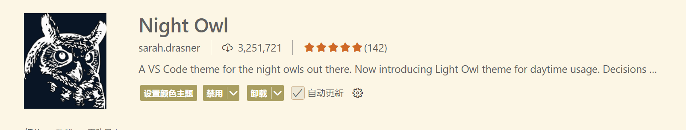

2. `One Dark Pro`

	一款非常推荐的暗色调主题，好看又护眼。

	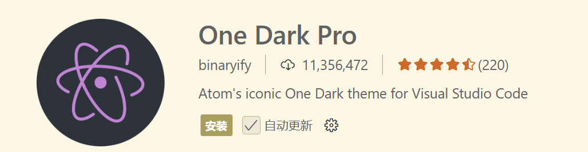

3. `GitHub Theme`

	GitHub 的官方主题

	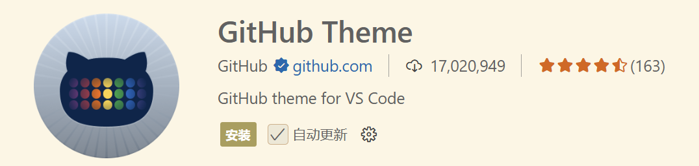

4. `Dracula Official`

	一款很有特点的吸血鬼主题

	

### 图标主题

 - `Material Icon Theme`

	个人正在用的图标主题，好看，类型大而全

	

## 背景

1. `Vibrancy Continued`

	使 vscode 背景高斯模糊，非常吃性能（慎用

	使用方法：按 `F1` 或者 `ctrl+shift+p`，键入 `Reload Vibrancy`，然后重启 vscode

	取消方法：按 `F1` 或者 `ctrl+shift+p`，键入 `Disable Vibrancy`，然后重启 vscode

	

## 基础功能类

1. `Chinese (Simplified) (简体中文)`

	【中文语言包】这应该不用多介绍，是 vscode 的官方中文语言包

	

2. `Error Lens`

	【错误提示】可以将原先显示的问题显示在对应行右侧并高亮

	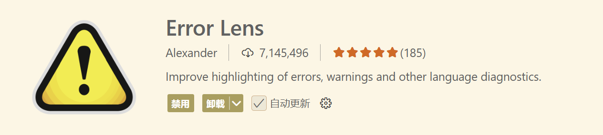

3. `Path Intellisense`

	【路径补全】在输入路径时，有智能提示补全

	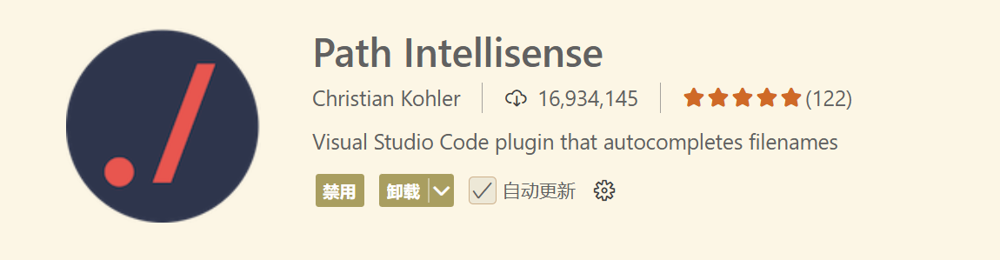

4. `Image preview`

	【图像预览】可以预览引入的图像

	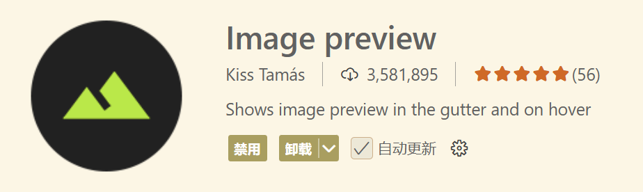

## 拓展功能类

1. `CodeSnap`

	【代码截图】一款非常好用的代码截图插件

	**使用方法**:Open the command palette (Ctrl+Shift+P on Windows and Linux, Cmd+Shift+P on OS X) and search for `CodeSnap`

	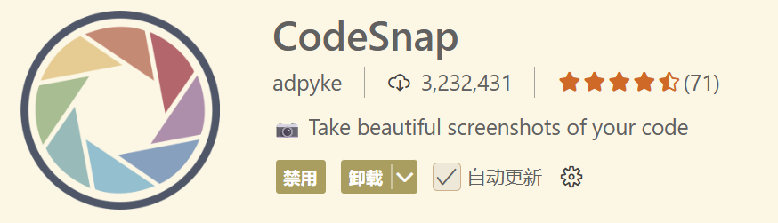

2. `Prettier - Code formatter`

	【代码格式化工具】支持超多语言，一键格式化，美化代码格式

	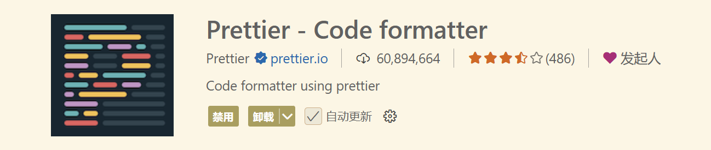

3. `GBK to UTF8 for vscode`

	【文件编码转化】可以将文件在 GBK 与 UTF8 编码之间无瑕转换

	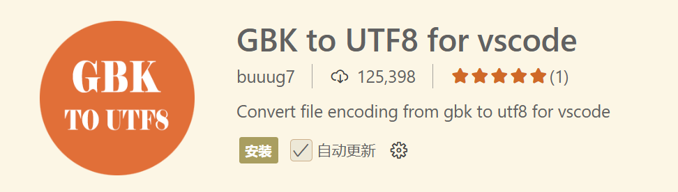

4. `Hex Editor`

	用来查看文件的 hex 或 UTF-8 编码

	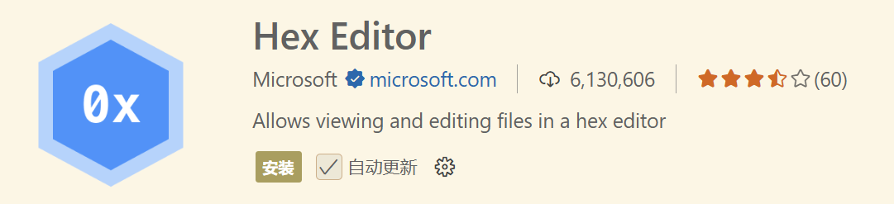

5. `Doxygen Documentation Generator`

	【文档生成器】写注释和文档时非常好用

	默认的使用方法为：在==代码文件头==或者==自定义函数==上方的位置输入：/ ** 然后 enter 键,则会自动生成相应的注释

	自定义代码格式可以通过：File–>Preference–>Settings–>Extensions–>Doxygen Documentation Generator Settings 设置相应的格式

	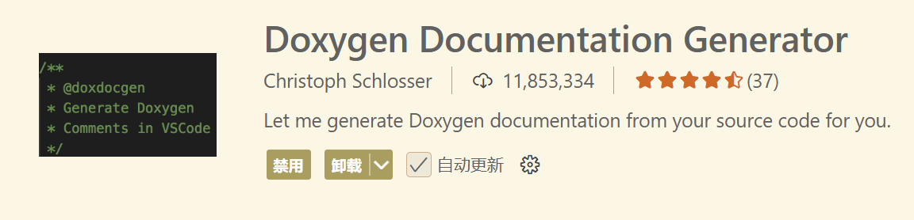

6. `Remote - SSH`

	【ssh 连接】连接远程服务器或虚拟机

	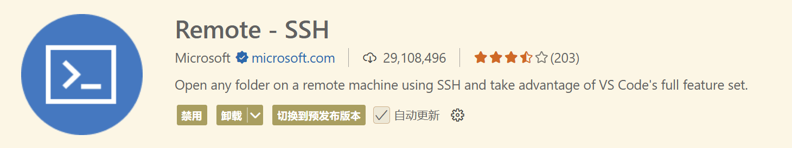

7. `Hungry Delete`

	【像 IDEA 的退格键】删除整个空格或制表符块，并减少程序员按退格键所需的时间

	**使用方法**:ctrl+backspace

	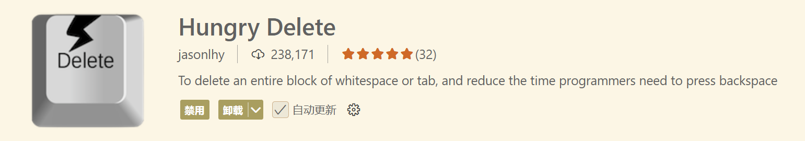

## 算法练习类

1. `Code Runner`

	【代码运行工具】支持多种语言，语言运行环境需自己配置

	推荐修改配置：

	```bash
    {
      "code-runner.runInTerminal": true,
      "code-runner.saveAllFilesBeforeRun": true,
      "code-runner.saveFileBeforeRun": true
    }
    ```

	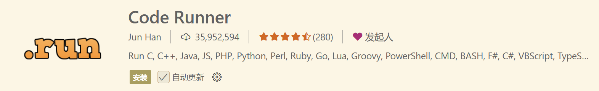

2. `Competitive Programming Helper (cph)`

	刷算法题时很好用，可以自己设置样例，一键全部运行

	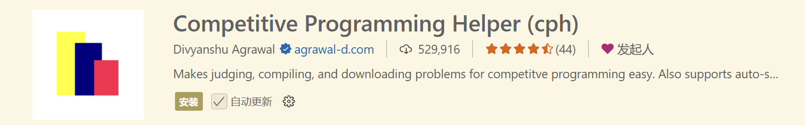

# 参考链接

[vscode优化使用体验篇（设置 \| 插件）\_vscode如何开启高帧率-CSDN博客](https://blog.csdn.net/qq_51173321/article/details/126287293)
