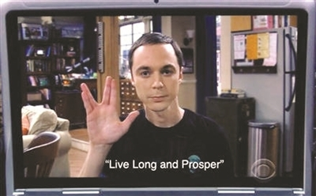

# 瓦肯举手礼详解

## 1 起源与背景

瓦肯举手礼（Vulcan Salute），又称“火神答复敬礼”，最初出现在美国著名科幻作品《星际迷航》（Star Trek）中，是瓦肯人用于问候的标志性手势 [1](https://zh.wikipedia.org/zh-hans/%E7%93%A6%E8%82%AF%E4%B8%BE%E6%89%8B%E7%A4%BC)[2](https://baike.baidu.com/item/%E7%93%A6%E8%82%AF%E4%B8%BE%E6%89%8B%E7%A4%BC/9025434)。该手势由斯波克（Spock）的扮演者伦纳德·尼莫伊（Leonard Nimoy）在拍摄过程中提出，灵感来自他童年时参加犹太教祈福仪式时见到的“kohane blessing”手势——该手势象征希伯来字母“ש”，寓意“上帝”[1](https://zh.wikipedia.org/zh-hans/%E7%93%A6%E8%82%AF%E4%B8%BE%E6%89%8B%E7%A4%BC)[2](https://baike.baidu.com/item/%E7%93%A6%E8%82%AF%E4%B8%BE%E6%89%8B%E7%A4%BC/9025434)[3](http://qnck.cyol.com/content/2010-04/27/content_3204214.htm)。

## 2 手势做法

瓦肯举手礼的具体做法如下：

- 将中指与食指并拢
- 将无名指与小指并拢
- 尽可能张开大拇指，与其余手指分开

这一手势对手指的灵活性有一定要求，现实中并非每个人都能轻松做到 [2](https://baike.baidu.com/item/%E7%93%A6%E8%82%AF%E4%B8%BE%E6%89%8B%E7%A4%BC/9025434)[3](http://qnck.cyol.com/content/2010-04/27/content_3204214.htm)。

## 3 文化意义与流行

- **祝词**：瓦肯举手礼常伴随一句著名的祝词“Live long and prosper”，中文常译为“生生不息，繁荣昌盛”或“健康长寿，繁荣昌盛”[1](https://zh.wikipedia.org/zh-hans/%E7%93%A6%E8%82%AF%E4%B8%BE%E6%89%8B%E7%A4%BC)[2](https://baike.baidu.com/item/%E7%93%A6%E8%82%AF%E4%B8%BE%E6%89%8B%E7%A4%BC/9025434)[4](https://m.qidian.com/ask/qhvzfxaycwz)。
- **象征意义**：最初仅为虚构外星文明的问候方式，如今已成为科幻迷、科技圈、网络文化中“来自另一星球”的象征符号 [2](https://baike.baidu.com/item/%E7%93%A6%E8%82%AF%E4%B8%BE%E6%89%8B%E7%A4%BC/9025434)[4](https://m.qidian.com/ask/qhvzfxaycwz)[3](http://qnck.cyol.com/content/2010-04/27/content_3204214.htm)。
- **Unicode 表情**：2014 年，瓦肯举手礼被纳入 Unicode 标准，成为🖖（U+1F596）表情符号 [1](https://zh.wikipedia.org/zh-hans/%E7%93%A6%E8%82%AF%E4%B8%BE%E6%89%8B%E7%A4%BC)。

## 4 趣闻轶事

- 在《星际迷航》拍摄过程中，扮演柯克舰长的威廉·夏特纳因无法独立做出该手势，只能借助鱼线或胶水辅助 [2](https://baike.baidu.com/item/%E7%93%A6%E8%82%AF%E4%B8%BE%E6%89%8B%E7%A4%BC/9025434)[3](http://qnck.cyol.com/content/2010-04/27/content_3204214.htm)。
- 该手势并非人人天生能做，许多演员和粉丝都曾尝试模仿，成为流行梗 [2](https://baike.baidu.com/item/%E7%93%A6%E8%82%AF%E4%B8%BE%E6%89%8B%E7%A4%BC/9025434)[3](http://qnck.cyol.com/content/2010-04/27/content_3204214.htm)。

## 5 在流行文化中的影响

- 除了在《星际迷航》系列中频繁出现，瓦肯举手礼还被其他影视作品、网络表情和现实活动广泛使用，成为跨文化交流的趣味象征 [1](https://zh.wikipedia.org/zh-hans/%E7%93%A6%E8%82%AF%E4%B8%BE%E6%89%8B%E7%A4%BC)[2](https://baike.baidu.com/item/%E7%93%A6%E8%82%AF%E4%B8%BE%E6%89%8B%E7%A4%BC/9025434)[4](https://m.qidian.com/ask/qhvzfxaycwz)。
- 该手势也常被用作和平、祝福和友好的象征，超越了原有的科幻语境 [1](https://zh.wikipedia.org/zh-hans/%E7%93%A6%E8%82%AF%E4%B8%BE%E6%89%8B%E7%A4%BC)[4](https://m.qidian.com/ask/qhvzfxaycwz)。

## 6 总结

瓦肯举手礼不仅是《星际迷航》的标志性符号，更因其独特的文化内涵和象征意义，在全球范围内流行，成为科幻文化和网络社交中的经典手势 [1](https://zh.wikipedia.org/zh-hans/%E7%93%A6%E8%82%AF%E4%B8%BE%E6%89%8B%E7%A4%BC)[2](https://baike.baidu.com/item/%E7%93%A6%E8%82%AF%E4%B8%BE%E6%89%8B%E7%A4%BC/9025434)[4](https://m.qidian.com/ask/qhvzfxaycwz)。

---

**参考文献**：

[1](https://zh.wikipedia.org/zh-hans/%E7%93%A6%E8%82%AF%E4%B8%BE%E6%89%8B%E7%A4%BC) [维基百科：瓦肯举手礼](https://zh.wikipedia.org/zh-hans/%E7%93%A6%E8%82%AF%E4%B8%BE%E6%89%8B%E7%A4%BC)

[2](https://baike.baidu.com/item/%E7%93%A6%E8%82%AF%E4%B8%BE%E6%89%8B%E7%A4%BC/9025434) [百度百科：瓦肯举手礼](https://baike.baidu.com/item/%E7%93%A6%E8%82%AF%E4%B8%BE%E6%89%8B%E7%A4%BC/9025434)

[4](https://m.qidian.com/ask/qhvzfxaycwz) [起点中文：瓦肯举手礼的功能](https://m.qidian.com/ask/qhvzfxaycwz)

[3](http://qnck.cyol.com/content/2010-04/27/content_3204214.htm) [青年参考：五种流行手势背后的故事](http://qnck.cyol.com/content/2010-04/27/content_3204214.htm)
