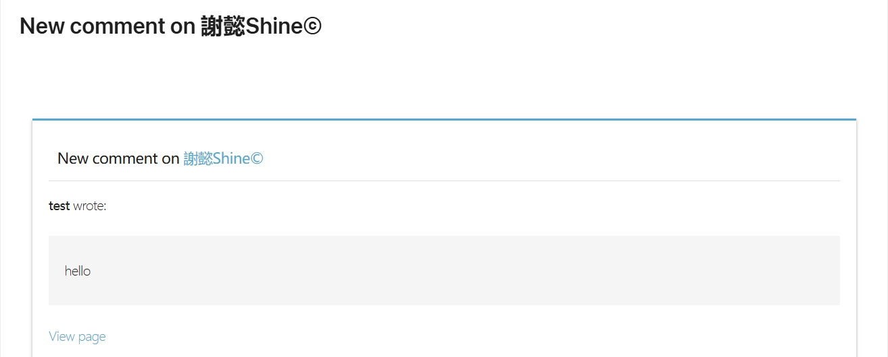
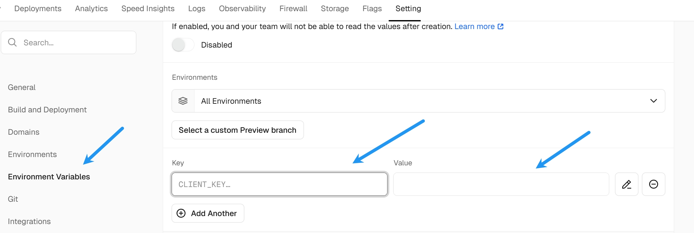
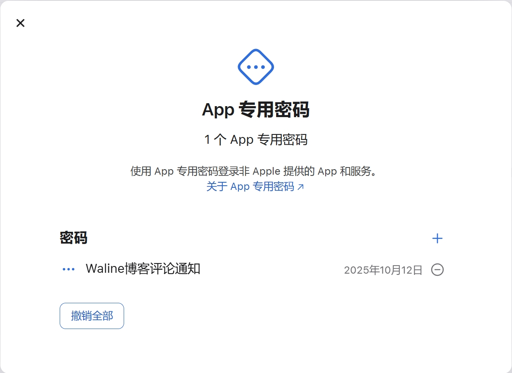
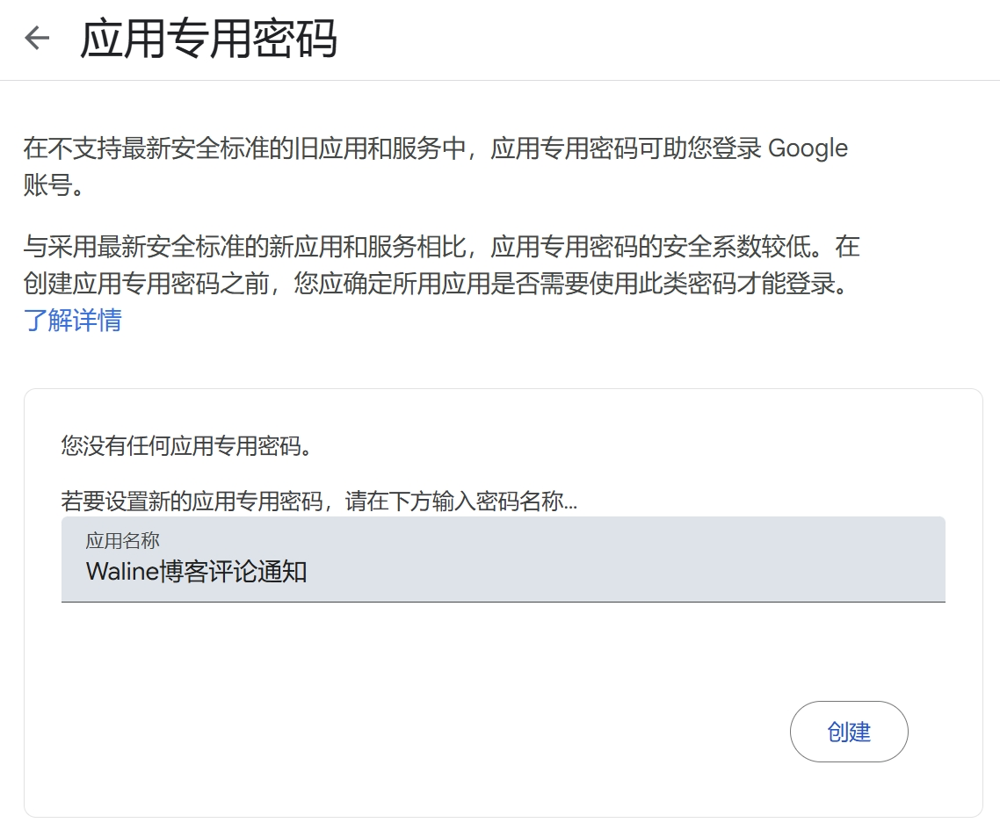

# 使用 Waline 实现 iCloud 和 Gmail 邮件通知的完整配置教程

Waline 是一款轻量级且高度可定制的评论系统，自带邮件通知功能可以有效提升用户互动体验。本文将分享如何配置 Apple 的 iCloud 邮箱和 Google 的 Gmail 邮箱，实现可靠且专业的邮件通知。



***

## 环境准备

- 已完成 Waline 评论系统搭建
- 具备 iCloud 邮箱账号
- 具备 Gmail 邮箱账号
- 有能力修改项目环境变量并重新部署 (在 Vercel 中配置)


***

## 一、iCloud 邮箱邮件通知配置

### 1. iCloud SMTP 配置参数

| 参数           | 示例                    | 说明                          |
| ------------ | --------------------- | --------------------------- |
| SMTP_HOST    | smtp.mail.me.com      | iCloud SMTP 服务器地址           |
| SMTP_PORT    | 587                   | 使用现代标准 587 端口（STARTTLS）     |
| SMTP_SECURE  | false                 | 587 端口需设为 false，使用 STARTTLS |
| SMTP_USER    | user@example.com | iCloud 邮箱地址                 |
| SMTP_PASS    | 应用专用密码                | 非邮箱登录密码，需生成应用专用密码           |
| SITE_NAME    | 你的网站名称                | 网站名称，用于邮件内容显示               |
| SITE_URL     | https://你的站点域名.com    | 网站网址，用于邮件内容链接               |
| AUTHOR_EMAIL | user@example.com | 博主邮箱，接收新评论通知                |
| SENDER_NAME  | 博客通知                  | 自定义邮件发件人名称                  |
| SENDER_EMAIL | user@example.com | 自定义邮件发件地址                   |

> **注意**：iCloud 需要使用 “应用专用密码” 代替登录密码，确保 SMTP 认证成功。

### 2. 应用专用密码获取方式

- 访问 Apple's [Apple ID 账户页面](https://appleid.apple.com/)
- 开启两步验证或双因素认证
- 生成新的应用专用密码，复制用于 `SMTP_PASS`


### 3. 重要说明

- `SMTP_SECURE` 需设置为 `false`，因为 587 端口使用 STARTTLS，非直接 SSL 连接。
- 使用 465 端口时，需要设置 `SMTP_SECURE=true`，但会导致部分云平台连接失败。

***

## 二、Gmail 邮箱邮件通知配置

### 1. Gmail SMTP 配置参数

| 参数           | 示例                   | 说明                  |
| ------------ | -------------------- | ------------------- |
| SMTP_SERVICE | Gmail                | 使用 Nodemailer 支持的服务 |
| SMTP_USER    | user@example.com | Gmail 邮箱地址          |
| SMTP_PASS    | 应用专用密码               | Gmail 应用专用密码，需要另行生成 |
| SITE_NAME    | 网站名称                 | 网站名称，用于邮件内容显示       |
| SITE_URL     | https://你的站点域名.com   | 网站网址，用于邮件内容链接       |
| AUTHOR_EMAIL | user@example.com | 博主邮箱，接收新评论通知        |

### 2. 应用专用密码获取方式

- 登录 Google 账户，进入 [应用专用密码页面](https://myaccount.google.com/apppasswords)
- 为你的 Waline 服务生成应用专用密码
- 将生成的密码填入 `SMTP_PASS`


### 3. Gmail 配置要点

- 推荐通过环境变量指定 `SMTP_SERVICE=Gmail`，简化配置
- 确保开启 Gmail “允许安全性较低的应用”或启用两步验证并使用应用专用密码

***

## 三、Waline 环境变量配置示例

```bash

# iCloud 配置（使用587端口）

SMTP_HOST=smtp.mail.me.com

SMTP_PORT=587

SMTP_SECURE=false

SMTP_USER=user@example.com

SMTP_PASS=你的应用专用密码

SITE_NAME=MyBlog

SITE_URL=https://myblog.com

AUTHOR_EMAIL=user@example.com

SENDER_NAME=MyBlog通知

SENDER_EMAIL=user@example.com

  

# Gmail 配置

SMTP_SERVICE=Gmail

SMTP_USER=user@example.com

SMTP_PASS=你的Gmail应用专用密码

SITE_NAME=MyBlog

SITE_URL=https://myblog.com

AUTHOR_EMAIL=user@example.com

```

***

## 四、部署与验证

1. 设置环境变量后，在项目平台（如 Vercel）重新部署应用。
2. 使用非博主邮箱发表评论，验证是否能成功发送邮件通知。
3. 检查收件箱及垃圾邮件，确认邮件是否到达。
4. 如邮件被误判为垃圾邮件，加入白名单。

***

## 五、常见问题与解决方案

| 问题                               | 解决方案                                               |
| -------------------------------- | -------------------------------------------------- |
| SMTP 连接报错 `wrong version number` | 关闭 SSL 开启 STARTTLS，即设置 `SMTP_SECURE=false` 和端口 587 |
| 邮件发送成功但收不到邮件                     | 检查垃圾邮件箱，添加发件人至白名单                                  |
| 认证失败                             | 使用正确的应用专用密码替换登录密码                                  |
| 465 端口连接超时                       | 改用 587 端口并关闭直接 SSL (SMTP_SECURE=false)             |
