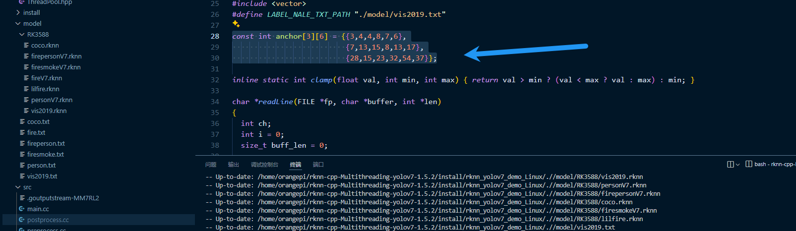

## 多线程 YOLO7

- 8 个并行线程
- 8 个模型实例并行
- 同时处理 8 帧
- 实时视频流
- 摄像头/视频文件
- RTMP/RTSP 推流
- GPIO + 串口
- 高帧率实时处理

> 在此方案上修改 [GitHub - leafqycc/rknn-cpp-Multithreading](https://github.com/leafqycc/rknn-cpp-Multithreading)

# 局域网内调试

> 用网线直连笔记本的以太网口与 RK3588 的以太网口

> 在 Windows 开启“Internet 连接共享”(ICS)，把 Wi‑Fi 共享到以太网

> - 右键 Wi‑Fi → 属性 → 切换到“共享”选项卡
> - 勾选“允许其他网络用户通过此计算机的 Internet 连接来连接
> - 完成以上设置后，VS Code 可通过 Remote‑SSH 连接 RK3588：在 VS Code/终端使用 ssh 用户名@192.168.137.x 进行连接。RK3588 端只要 sshd 运行、网线直连、且已拿到 192.168.137.x 地址即可

---

> 或者可以添加网段
> sudo ip addr add 192.168.137.3/24 dev eth0

# 主机端操作

## 模型训练

> 我使用 docker 挂载 file 文件夹中的 code、data、rknn

```python
docker attach yolov7
```

> 训练

```python
# 开始
python train.py --data data/VisDrone.yaml --name yolov7-vis2019

# 恢复
python train.py --resume
#or 指定恢复
python train.py --resume runs/train/yolov7-vis2019/weights/last.pt
```

## best.pt 转换为 onnx 模型

```python
python export.py --rknpu rk3588 --weight ./runs/train/yolov7-vis2019/weights/best.pt # ./当前目录
```

## onnx 转 rknn 模型 (安装 rknn-toolkit 工具)

> **Note:**
> 请注意,要在此项目上运行新的 onnx 转 rknn 的模型,需要特定的 toolkit 版本 ->1.5.2
> [GitHub - airockchip/rknn-toolkit2 at v1.5.2](https://github.com/airockchip/rknn-toolkit2/tree/v1.5.2)

```python
# python
conda activate rknntoolkit

pip install rknn_toolkit2-1.5.2+b642f30c-cp36-cp36m-linux_x86_64.whl
```

> 在 file/rknn/rknn_model_zoo/examples/yolov7/python 中运行代码进行 onnx -> rknn

```python
python convert.py ../model/best.onnx rk3588
```

# 板端操作

```bash
#烧入镜像后修改 orangepi 初始密码并通过 orange-config 设置串口 0/1

sudo passwd orangepi  # 按提示设置独立的强密码

#赋予整个文件夹执行权限

sudo chmod -R +x /home/orangepi/rknn-cpp-Multithreading-yolov7-1.5.2

#安装依赖
sudo apt-get update

sudo apt install cmake gstreamer1.0-rtsp libopencv-dev

#增强性能

sudo ./performance.sh

#自启动

mv detect.desktop ../.config/autostart/


##说明

postprocess.h 文件定义了解析和翻译神经网络原始输出的规则和工具，是连接“AI 模型推理”和“最终可用结果”之间的桥梁。

postprocess.cc 是 postprocess.h 的具体实现。
```

## 修改模型后需要的步骤

> 基础修改

```bash
将转换好的模型拷贝至部署代码的model/RK3588的文件夹中，同时参照model文件夹中的文本编写类别信息

修改include/postprocess.h中OBJ_CLASS_NUM（类别数） 

和src/postprocess.cc的LABEL_NALE_TXT_PATH（类别信息文本的地址）
```

> 记得修改锚点数组数据

- 通常换新的模型,输出的锚点会不同 RK_anchors


> 修改模型后记得重新编译

```bash
./build-linux_RK3588.sh
```

# 手动启动

```bash
./start.sh
```
