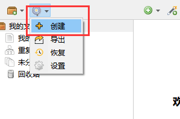
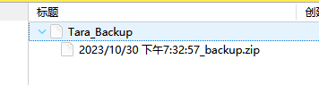
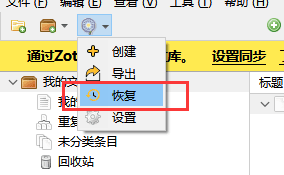
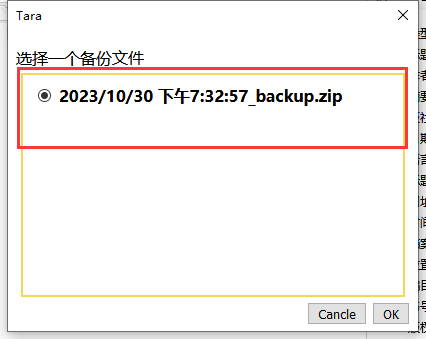
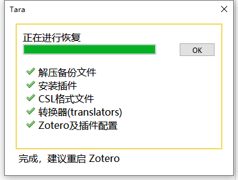
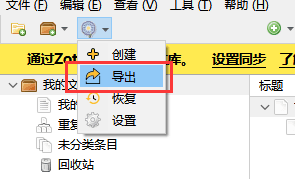
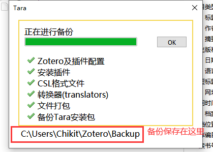
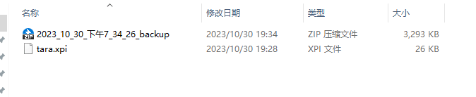

> 原文 [蒲公英 \| Zotero 中文社区](https://zotero-chinese.com/user-guide/plugins/tara)

# 蒲公英 Tara

> Tara 是一个用于备份和恢复 Zotero 配置的插件

✅ 备份已安装插件

✅ 备份 CSL 文件

✅ 备份转换器 (translators)

✅ 备份 Locate 文件夹

✅ 备份 Zotero 配置及插件配置

下载地址：

- [GitHub](https://github.com/l0o0/tara)
- [中文社区插件合集页](https://zotero-chinese.com/plugins/#search-%E8%92%B2%E5%85%AC%E8%8B%B1)
	搜索 蒲公英

# 1 创建备份 [​](#%E5%88%9B%E5%BB%BA%E5%A4%87%E4%BB%BD) {#创建备份}

下载安装 Tara 插件后，通过点击 `Tara` 图标来创建一个备份

创建成功后，会在 Zotero 中生成一个 `Tara_backup` 的条目并自动生成一个 ZIP 格式的附件，这个就是备份文件。

如果你再点一次创建，会再生成个附件，你可以选择不同时间段的备份文件进行恢复。

# 2 恢复备份 [​](#%E6%81%A2%E5%A4%8D%E5%A4%87%E4%BB%BD) {#恢复备份}

点击 `恢复`

可以根据时间来选择要恢复的备份

等待备份恢复完成，再重启 Zotero

# 3 导出备份文件 [​](#%E5%AF%BC%E5%87%BA%E5%A4%87%E4%BB%BD%E6%96%87%E4%BB%B6) {#导出备份文件}

点击 `导出`

等待完成后，去备份目录查看文件是否生成

导出时，会将当成的配置信息和插件导出到一个单独 ZIP 文件中，导出的备份会默认储存在 `数据储存文件夹\backup` 下。

# 4 在新电脑上进行数据恢复 [​](#%E5%9C%A8%E6%96%B0%E7%94%B5%E8%84%91%E4%B8%8A%E8%BF%9B%E8%A1%8C%E6%95%B0%E6%8D%AE%E6%81%A2%E5%A4%8D) {#在新电脑上进行数据恢复}

在新电脑上安装了 Zotero，此时 Zotero 上没有任何插件，配置都是默认的。这时，你可以将 [导出备份文件](#%E5%AF%BC%E5%87%BA%E5%A4%87%E4%BB%BD%E6%96%87%E4%BB%B6) 导出的文件复制到新电脑上。

在新电脑 Zotero 上，先安装 `Tara.xpi` 插件。

插件安装成功，点击恢复，会出现一个文件选择的窗中，选择 [导出备份文件](#%E5%AF%BC%E5%87%BA%E5%A4%87%E4%BB%BD%E6%96%87%E4%BB%B6) 中所生成的备份文件，之后 Zotero 会恢复对应的插件及相关配置。

# 5 在不同电脑上同步备份 [​](#%E5%9C%A8%E4%B8%8D%E5%90%8C%E7%94%B5%E8%84%91%E4%B8%8A%E5%90%8C%E6%AD%A5%E5%A4%87%E4%BB%BD) {#在不同电脑上同步备份}

当你在多个电脑上同时使用 Zotero 时，可以通过 Zotero 的 `同步功能` 来实现数据的快速备份和恢复。

首先在不同电脑上分别配置同步，然后可以在 A 电脑上创建一个备份，备份文件是随条目一起同步的。那 B 电脑 Zotero 应该会自动同步了创建的备份条目 `Tara_backup` 及对应的附件。

当你在 B 电脑的 Zotero 上点击恢复，选择 A 电脑上刚创建的备份。这样两台电脑上的 Zotero 配置和插件信息就一起同步了。

注意修改 Tara 的「备份 Locate」设置

由于不同系统平台或主机上的文件路径可能不一致，tara 在备份时默认过滤掉了 `locate` 文件夹，可以通过点击 `Tara 图标-设置` 进行修改。
